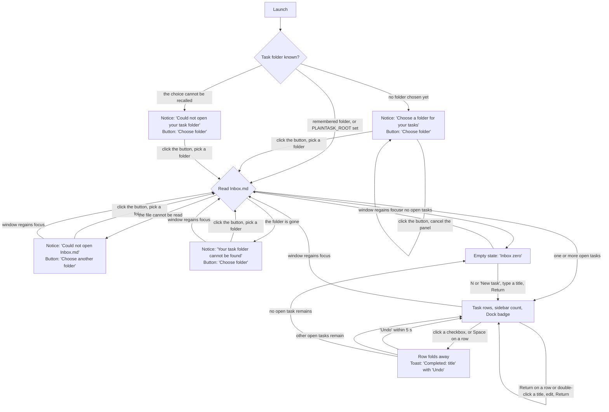

# Plaintask desktop feature map

This directory lists every user-facing feature of the Plaintask desktop app (`apps/desktop`). People read it to learn what the app does, its user flows and its use cases. Coding agents read it before they drive the app: each feature file is the recipe for reaching, driving and proving one feature. Read this index first, then open the matching feature file.

## The app in one screen

The app has one window, 880 by 620 points at first launch, with no title bar. It shows one list, Inbox, backed by the file `Inbox.md` in a folder the person picks.

| Region | Holds |
| --- | --- |
| Top strip | Empty. A real mouse drag on it moves the window. The traffic lights sit at its left, over the sidebar. |
| Sidebar (left) | A navigation region named `Lists` with one item, `Inbox`. The item carries the count of open tasks. The count is blank at zero. |
| Header (top of the main area) | The heading `Inbox`. The button `New task` with the key hint `N`, shown only while an Inbox is on screen. |
| New-task form (under the header) | Closed until opened. A field labelled `Task` with the placeholder `e.g. Call the tiler`, an error line, and the buttons `Cancel` and `Add task`. |
| List (rest of the main area) | One of three things: the task rows, the empty state `Inbox zero`, or a notice with one button (`Choose folder` or `Choose another folder`). Each row has a checkbox named `Complete: <title>` and the title. A long title wraps onto more lines. |
| Toasts (bottom) | Messages that stay for 5 s. At most two show at once. A completed task's toast reads `Completed: <title>` and has the button `Undo`. A message too long for the window is cut short with `…`, and the button stays on screen. |
| Dock icon | A badge with the same number as the sidebar count. No badge at zero. |

## User flows



Every edit (add, complete, Undo, rename) reads `Inbox.md` from disk, changes it and saves it. Lines another editor wrote since the last read stay in the file. An edit made after the folder has gone saves nothing and shows the notice `Your task folder cannot be found`. An edit to a file that is read-only, locked or hard-linked saves nothing and shows a toast with the reason.

## Use cases

1. As a person who keeps tasks as plain Markdown files in a folder I own, I point the app at that folder once and it opens there on every launch. See [Choose the task folder](./choose-task-folder.md).
2. As a person who wants to know what is open, I read the Inbox list, the sidebar count and the Dock badge. See [View the Inbox](./view-inbox.md).
3. As a person who thinks of a task in the middle of other work, I press `N`, type the title and press Return. See [Add a task](./add-task.md).
4. As a person who works from the keyboard, I move between tasks, tick them and rename them without the mouse. See [Keyboard navigation](./keyboard-navigation.md), [Complete a task and Undo](./complete-task.md) and [Rename a task](./rename-task.md).
5. As a person who also edits `Inbox.md` in a text editor, or lets a script or an agent write to it, I switch back to the app and it shows the file as it is. Its own edits keep my lines. See [View the Inbox](./view-inbox.md), [Add a task](./add-task.md), [Complete a task and Undo](./complete-task.md) and [Rename a task](./rename-task.md).

## Feature entry contract

Each feature file starts with an H1 title and one paragraph that describes the user-visible behaviour. It then uses exactly five H2 sections in this order.

1. `Use cases` gives one to three lines on who uses the feature and why.
2. `Sub-features` lists short kebab-case IDs with one line for each behaviour and edge case.
3. `How to get to it (user POV)` lists every user entry point: button, key and mouse gesture.
4. `Driving it with control-desktop` starts with `Preconditions:` and then has one labelled bullet per sub-feature. Each bullet gives the user action, the observable result, what `Inbox.md` on disk must contain afterwards, and the stable handle to target. Each bullet then ends in one of four ways: the `control-desktop` commands that were run and what each one printed; `Real window only: follow the checking-desktop-app skill.`, with a page-tier check where one exists and what that check does not show; `Not drivable: <reason>`; or `Command: TBD` where no pass has filled in and proved the command yet.
5. `Gotchas` lists mistakes that waste or invalidate a verification run.

Keep implementation details out of the map. Name only user paths, stable handles, required state, commands and observable proof.

## Baseline preconditions

The harness is the `verify-desktop` skill (`.claude/skills/verify-desktop/SKILL.md`). Load it before you drive anything. It has two tiers.

| Tier | What runs | Driven by |
| --- | --- | --- |
| Page | The built page in headless Chrome, on a task folder under `.verify/<id>/` | The helper `control-desktop` |
| Real window | The built, sandboxed app under the test identifier `com.airshiplabs.plaintask.dev` | The `checking-desktop-app` skill |

In every feature file, `control-desktop <command>` stands for this, run from the repo root:

```sh
.claude/skills/verify-desktop/scripts/control-desktop.mjs <command> --run <id>
```

`<id>` names one run. Add the same `--run <id>` to every command of a recipe. The feature files leave it out.

Page tier:

- Write the baseline file once, then launch each run on it:

```sh
mkdir -p .verify
printf '# Inbox\n\n- [ ] Buy milk\n- [ ] Call mum\n  - [ ] a subtask the app leaves alone\n- [x] Done already\n- [ ] Water plants\n' > .verify/baseline.md
.claude/skills/verify-desktop/scripts/control-desktop.mjs launch --inbox .verify/baseline.md --run <id>
```

- `launch` with no `--inbox` uses the helper's own seed file, which is not the baseline file. Every recipe that starts from the baseline passes `--inbox .verify/baseline.md`.
- `launch` exits 0 and its last line starts with `ready:`. Then run `control-desktop doctor`. It ends with `healthy`. Run `doctor` again after any command that fails in a way the recipe does not state.
- `launch` refuses a run id that still has scratch state. Run `control-desktop cleanup` first, or use a new id.
- Do not run `launch` while `pnpm test` runs in the same checkout. Both rebuild `apps/desktop/dist`.
- Drive only a run that you launched. Give each agent its own run ids. Do not clean up another agent's run.
- Run `control-desktop cleanup` for every run you launched, a failed one included. It stops the run's processes and keeps `.verify/<id>/evidence/`.

Real window:

- Drive only an app instance that this verification run started.
- Never drive a build that carries the identifier `com.airshiplabs.plaintask`. That build shares its container and its remembered folder with the installed app, so typing into it writes to the person's own `Inbox.md`.
- Use a disposable task folder that holds nothing the person owns.
- The screen is unlocked and awake. macOS paints no new window while the screen is locked.

Both tiers:

- Unless a feature file says otherwise, the task folder holds `Inbox.md` with this text, with `\n` line endings and a final newline. Feature files call it the baseline file. It is 116 bytes.

```markdown
# Inbox

- [ ] Buy milk
- [ ] Call mum
  - [ ] a subtask the app leaves alone
- [x] Done already
- [ ] Water plants
```

- With the baseline file, the list shows three rows in this order: `Buy milk`, `Call mum`, `Water plants`. The sidebar count is `3`. The Dock badge is `3`. In the page tier, `control-desktop snapshot` prints `sidebar badge: 3` and `dock badge: 3`.

## Driving conventions

- Start every recipe from the baseline state unless its preconditions say otherwise.
- Target a control by its role and accessible name first, then by a data attribute, then by visible text. Do not target by position.
- The stable handles are:

| Thing | Handle |
| --- | --- |
| Sidebar | navigation named `Lists`; item with text `Inbox`, `data-view="inbox"` |
| Sidebar count | `[data-badge="inbox"]` |
| Header | heading `Inbox`; button with text `New task` and key hint `N` inside `[data-head]` |
| New-task form | `[data-composer]`; textbox labelled `Task`; buttons `Cancel` and `Add task`; error line `[data-composer] .pt-error` |
| List | `[data-list]` |
| Row | `li[data-row="<n>:<title>"]`, where `<n>` is `0` for the first task with that title, `1` for the second |
| Row checkbox | role `checkbox`, name `Complete: <title>`, state `aria-checked` |
| Row title | `.pt-task__title` inside the row |
| Rename field | textbox named `Rename: <title>` |
| Empty state and notices | role `status` inside `[data-list]`; the bold line is the title |
| Notice button | button inside `[data-choose]` |
| Toast | `[data-toasts] .pt-toast`; the button `Undo` inside it |

- Quote titles, visible strings and key names exactly as the feature file has them.
- In the page tier, name a target with exactly one of `--role <role> --name <name>`, `--selector <css>` or `--text <exact text>`. `click` and `fill` fail when several elements match; add `--nth <n>`. With `--nth <n>`, `wait` passes when `n` or more match, and `wait --gone` passes when fewer than `n` match.
- Page-tier checks that a thing is present: `control-desktop wait <target>` exits 0. Checks that a thing is absent: `control-desktop wait <target> --gone --timeout 500` exits 0. Without `--timeout`, a failing `wait` takes 10 s.
- Page-tier check of row order: `control-desktop wait --selector '[data-list] li:nth-child(<n>)[data-row="<occurrence>:<title>"]'`. Check of the row count: `control-desktop wait --selector '[data-list] li:nth-child(<count + 1>)' --gone --timeout 500`.
- Page-tier check of the counts: `control-desktop snapshot | grep -x 'sidebar badge: 3'` and `control-desktop snapshot | grep -x 'dock badge: 3'`. A blank sidebar count prints `sidebar badge: none`. The snapshot line `commands since load` counts each command the page called; `write_inbox 0` means the page saved nothing since it loaded.
- Page-tier check of the file: `control-desktop file | cmp - <file with the expected bytes>`, or `cmp - <(printf '...')`. `cmp` prints nothing and exits 0 on a match. `control-desktop file` exits 3 when the folder has no `Inbox.md`.
- A recipe that needs another file writes it under `.verify/` with `printf` and launches with `--inbox <file>`, or replaces the running file with `control-desktop external --from <file>` and then `control-desktop refocus`.
- What the page tier stands in for: `panel pick|cancel` is the folder panel's answer, `refocus` is the window regaining focus, `reload` is a relaunch with the folder still chosen, `external` is another editor, `external --move-folder` and `external --return-folder` are a task folder that is moved away and put back, and `fail read|write|folder "<message>"` is a failure with that reason. The skill's section "Simulating what is outside the page" lists them.
- A ticked row stays for about 1 s and a toast for about 5 s. Use `wait`, not a fixed sleep.
- In the real window, keys reach the window while it is in the background: `N`, Return, Escape, `j`, `k`, the arrow keys and Space.
- In the real window, three things need a real mouse on the frontmost window: the system folder panel, a drag of the window by its top strip, and a double-click. The page tier sends a double-click with `control-desktop click <target> --double`.
- The page tier does not cover the folder panel, the remembered folder, `PLAINTASK_ROOT`, the app's file layer, the Dock icon, a right-click menu or a window drag. A bullet that needs one of them says `Real window only: follow the checking-desktop-app skill.`
- The app's file layer decides four things the page only reports: a file that is not UTF-8 is not read, a file that is read-only, locked or hard-linked is not saved, a folder that is gone is not an empty Inbox, and a save keeps the file's metadata. The helper refuses the same files with the same texts, so a page-tier check shows what the page does with the refusal. It does not show that the app refuses.
- A `snapshot` or `screenshot` sent as a second command after a tick can arrive after the row has left. Assert the ticked state in the click itself with `control-desktop click <target> --expect <css>`, and take the picture with `control-desktop click <target> --screenshot <name>`.
- A page-tier run starts from its own copy of the file, so launch a new run in place of restoring the baseline file. In the real window, restore the baseline file after a recipe that changes it. Do not remove proof artifacts during cleanup.
- A bullet that still ends with `Command: TBD` has no proved command yet.

## Proof and skip reporting

- Capture the user action and the resulting state. A final screen alone is not proof.
- After every step that can write, compare `Inbox.md` on disk byte for byte with the expected text. A row on screen does not show what was written.
- A step that must not write is proved by `Inbox.md` being byte for byte what it was before the step.
- Window proof shows the Plaintask window with the list, the sidebar count and any toast.
- Page-tier proof is saved with `control-desktop snapshot --save <name>` (state lines and the accessibility tree), `control-desktop screenshot <name>` (a PNG) and `control-desktop file --save <name>` (a byte copy of `Inbox.md`). They go to `.verify/<id>/evidence/`. An existing evidence file is never overwritten.
- `.verify/<id>/evidence/transcript.log` records every helper command and every command the page called, with a time. Keep it with the proof.
- A step that must not write is also shown by `write_inbox 0` in the snapshot, or by a `write_inbox` count that did not rise.
- Record the sub-feature ID and the entry point used with every artifact.
- A proof that drives one entry point does not cover the other entry points the feature file lists.
- Report an unreachable path with the attempted action and the unmet precondition.
- Do not report a skipped entry point as verified through a different path.
- State the tier of each proof: the real window, the page tier (`control-desktop`), or the page tests in headless Chrome (`tests/desktop-app.test.mjs`). The page tier and the page tests do not cover the folder panel, the remembered folder, the Dock icon, window dragging or a right-click menu.
- A page-tier check under a `Real window only` bullet proves the page's part and no more. Report it as a page-tier check of that part, not as proof of the sub-feature.
- A step that fails is reported as failed, with the command and its output. Do not change the step until it passes.
- Report a `Not drivable` bullet with its reason. Do not report it as verified.

## Features

- [Choose the task folder](./choose-task-folder.md) covers the first-launch request, the folder panel, cancelling, the remembered choice, the two folder notices at launch and the notice for a folder that has gone.
- [View the Inbox](./view-inbox.md) covers which lines are tasks, code blocks and HTML comments, long titles, the list, the empty state, the read-error notice and its recovery, the sidebar count, the Dock badge and the reread on window focus.
- [Add a task](./add-task.md) covers the new-task form, saving, a blank title, cancelling, the first task in an empty folder, a failed save and a folder that has gone.
- [Complete a task and Undo](./complete-task.md) covers ticking by mouse and by Space, the toast, Undo, a double-click on Undo, the last task, repeated ticks, long titles, failed saves and a read-only or hard-linked file.
- [Rename a task](./rename-task.md) covers opening the title field by Return and by double-click, saving, cancelling, a blank title and failed saves.
- [Keyboard navigation](./keyboard-navigation.md) covers `j`, `k` and the arrow keys, the full key list, and when keys are left alone.

## Not mapped

These exist in the repo and have no entry here.

- `sites/plaintask.ai`, `sites/plaintask.app` and `sites/plaintask.sh`: the three marketing sites.
- `apps/mobile`: not started. The folder holds a README and a changelog.
- `apps/sync`: not started. The folder holds a README and a changelog.
- `packages/design-system`: the component previews. The desktop app uses its components; the previews are not part of the app.
- Developer commands in `apps/desktop/README.md`: launch timing (`measure`), the speed budgets and the release build.

These are listed as "Not built yet" in `apps/desktop/README.md`. The app has no control for any of them, so do not search for one.

- Other lists
- Projects
- Areas
- Tags
- Dates
- Repeating tasks
- Trash
- Reordering
- A view of completed tasks
- A live file watcher
- Sync
