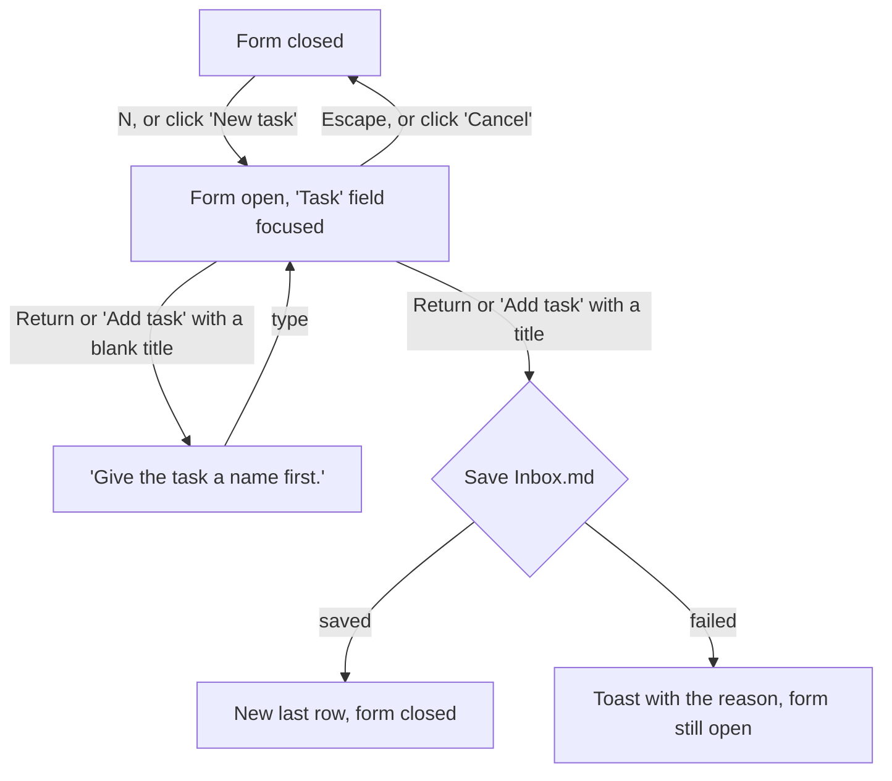

# Add a task

A person opens the new-task form with `N` or the `New task` button, types a title and presses Return. The task becomes the last line of `Inbox.md` and the last row of the list. Escape or `Cancel` closes the form and adds nothing. A blank title is refused with a message. A save that fails leaves the form open with the title in it.

## Use cases

- As a person who thinks of a task in the middle of other work, I press `N`, type it and press Return.
- As a person who starts with an empty folder, I add my first task and the app creates `Inbox.md`.

## Sub-features

- `add-open-key` opens the form on `N` or `n`, empty, with the keyboard in the `Task` field.
- `add-open-button` opens the same form on a click of `New task`.
- `add-save` appends `- [ ] <title>` as the last line of the file and shows it as the last row. The form closes, the keyboard returns to the `New task` button, and the sidebar count and the Dock badge go up by one.
- `add-save-button` saves on a click of `Add task`, the same as Return.
- `add-title-trimmed` writes the title with no space around it.
- `add-first-task` replaces `Inbox zero` with the row and creates `Inbox.md` with one line.
- `add-line-ending` writes the new line in the line ending the file already uses. A last line with no newline gets one first.
- `add-keeps-other-lines` keeps every other byte of the file, including lines another editor wrote since the app last read it.
- `add-duplicate-title` adds a task whose title another task already has. Both rows show.
- `add-blank-title` refuses a blank title: the message `Give the task a name first.` shows, the field is marked invalid, the form shakes and stays open, and nothing is written. Typing clears the message.
- `add-cancel-escape` closes the form on Escape and adds nothing. The keyboard returns to the `New task` button.
- `add-cancel-button` closes the form on a click of `Cancel` and adds nothing.
- `add-opens-empty` opens the form empty after a cancelled entry.
- `add-key-in-field` treats `N` typed in the `Task` field as a letter.
- `add-write-failure` shows a toast with the reason when the file cannot be saved. No row is added. The form stays open with the title.
- `add-folder-gone` saves nothing when the task folder has gone since the form opened. The form closes, the notice `Your task folder cannot be found` replaces the list, and a toast says the same. The folder is not made again.
- `add-needs-inbox` offers no `New task` button and ignores `N` while a notice is shown in place of the list.

- `add-long-list` scrolls a long list to its end, so the new row is in view as the last row.
- `add-saved-but-hidden` says so when the new line is saved but is not listed. A title that holds the Unicode line separator U+2028, which a paste can carry, reaches it.

## How to get to it (user POV)

- Press `N` while an Inbox is shown and the keyboard is not in a text field.
- Click the `New task` button in the header.
- In the open form: press Return in the `Task` field, or click `Add task`, to save.
- In the open form: press Escape, or click `Cancel`, to close without saving.

## Driving it with control-desktop

Preconditions:

- The app instance was started by this run on a disposable task folder.
- The folder holds the baseline file unless the bullet names another file.
- The list is showing and the keyboard is not in a text field.
- No row is titled `Order floor tiles`.
- Write the baseline file once: `mkdir -p .verify && printf '# Inbox\n\n- [ ] Buy milk\n- [ ] Call mum\n  - [ ] a subtask the app leaves alone\n- [x] Done already\n- [ ] Water plants\n' > .verify/baseline.md`.
- Start the run with `control-desktop launch --inbox .verify/baseline.md`, then `control-desktop doctor`. A bullet that names another launch command needs its own run id.
- Before each bullet, return to the baseline state: `control-desktop external --from .verify/baseline.md`, then `control-desktop reload`.
- Every command below was run in the page tier.

- **`add-open-key`.** Action: press `N`. Result: `[data-composer]` is open (not `inert`). The textbox `Task` has the keyboard, is empty, and shows the placeholder `e.g. Call the tiler`. File: byte for byte the baseline file. Handle: textbox `Task`. Command: Run `control-desktop press N`, then `control-desktop wait --selector '[data-composer]:not([inert])'` and `control-desktop wait --selector 'input[placeholder="e.g. Call the tiler"]:placeholder-shown:focus'`. Both waits print `found`. `control-desktop snapshot` prints `focus: textbox "Task"` and `write_inbox 0`. `control-desktop file | cmp - .verify/baseline.md` prints nothing and exits 0. `control-desktop press n` gives the same result.
- **`add-open-button`.** Action: click `New task`. Result: the same open form with the keyboard in `Task`. File: unchanged. Handle: button `New task` inside `[data-head]`. Command: Run `control-desktop click --role button --name "New task N"`, then `control-desktop wait --selector 'input[placeholder="e.g. Call the tiler"]:placeholder-shown:focus'`. The wait prints `found`. `control-desktop snapshot` prints `focus: textbox "Task"`. `control-desktop file | cmp - .verify/baseline.md` prints nothing and exits 0.
- **`add-save`.** Action: open the form, type `Order floor tiles`, press Return. Result: a fourth row `Order floor tiles` shows last. The form closes. The `New task` button has the keyboard. The sidebar count and the Dock badge read `4`. File: the baseline file plus the last line `- [ ] Order floor tiles` and a `\n`. Handle: textbox `Task`; `li[data-row="0:Order floor tiles"]`. Command: Run `control-desktop press n`, `control-desktop type "Order floor tiles"`, `control-desktop press Enter`. Then `control-desktop wait --selector 'li[data-row="0:Order floor tiles"]:last-child'` prints `found` and `control-desktop wait --role textbox --name "Task" --gone` prints `gone`. `control-desktop snapshot` prints `focus: button "New task N"`, `sidebar badge: 4`, `dock badge: 4`, `write_inbox 1` and four list items. `control-desktop file | cmp - <(cat .verify/baseline.md; printf -- '- [ ] Order floor tiles\n')` prints nothing and exits 0. `dock badge` is the count the page sent. The badge on the real Dock icon is real window only: follow the checking-desktop-app skill.
- **`add-save-button`.** Action: open the form, type `Order floor tiles`, click `Add task`. Result: the same as `add-save`. File: the same as `add-save`. Handle: button `Add task`. Command: Run `control-desktop click --role button --name "New task N"`, `control-desktop type "Order floor tiles"`, `control-desktop click --role button --name "Add task"`. Then `control-desktop wait --selector 'li[data-row="0:Order floor tiles"]:last-child'` prints `found` and `control-desktop wait --role textbox --name "Task" --gone` prints `gone`. `control-desktop snapshot` prints `focus: button "New task N"`, `sidebar badge: 4` and `dock badge: 4`. `control-desktop file | cmp - <(cat .verify/baseline.md; printf -- '- [ ] Order floor tiles\n')` prints nothing and exits 0.
- **`add-title-trimmed`.** Action: open the form, type two spaces, `Order floor tiles`, two spaces, then press Return. Result: the new row reads `Order floor tiles`. File: the last line is `- [ ] Order floor tiles` with no space after it. Handle: textbox `Task`. Command: Run `control-desktop press n`, `control-desktop type "  Order floor tiles  "`. `control-desktop snapshot` prints `textbox "Task" [value="  Order floor tiles  ", focused]`. Run `control-desktop press Enter`. Then `control-desktop wait --selector 'li[data-row="0:Order floor tiles"]:last-child'` and `control-desktop wait --text "Order floor tiles"` print `found`. `control-desktop file | cmp - <(cat .verify/baseline.md; printf -- '- [ ] Order floor tiles\n')` prints nothing and exits 0.
- **`add-first-task`.** Precondition: the folder has no `Inbox.md` and the list shows `Inbox zero`. Action: click `New task`, type `Buy milk`, press Return. Result: one row `Buy milk` shows. `Inbox zero` is gone. The sidebar count reads `1`. File: `Inbox.md` exists and is exactly `- [ ] Buy milk` and a `\n`. Handle: button `New task`; textbox `Task`. Command: Start a run with `control-desktop launch --no-inbox`. `control-desktop wait --text "Inbox zero"` prints `found` and `control-desktop file` exits 3. Run `control-desktop click --role button --name "New task N"`, `control-desktop type "Buy milk"`, `control-desktop press Enter`. Then `control-desktop wait --selector 'li[data-row="0:Buy milk"]:only-child'` prints `found` and `control-desktop wait --text "Inbox zero" --gone` prints `gone`. `control-desktop snapshot` prints `sidebar badge: 1` and `Inbox.md: 15 bytes`. `control-desktop file | cmp - <(printf -- '- [ ] Buy milk\n')` prints nothing and exits 0.
- **`add-line-ending`.** Precondition: `Inbox.md` is `# Inbox`, `- [ ] One`, `- [ ] Two` with `\r\n` between lines and no line ending after `Two`. Action: add `Three`. Result: three rows `One`, `Two`, `Three`. File: `# Inbox\r\n- [ ] One\r\n- [ ] Two\r\n- [ ] Three\r\n`. Handle: textbox `Task`. Command: Run `printf '# Inbox\r\n- [ ] One\r\n- [ ] Two' > .verify/crlf.md`, then start a run with `control-desktop launch --inbox .verify/crlf.md`. Run `control-desktop press n`, `control-desktop type "Three"`, `control-desktop press Enter`. Then `control-desktop wait --selector 'li[data-row="0:Three"]:last-child'` prints `found`. `control-desktop snapshot` lists the checkboxes `Complete: One`, `Complete: Two`, `Complete: Three` in that order. `control-desktop file | cmp - <(printf '# Inbox\r\n- [ ] One\r\n- [ ] Two\r\n- [ ] Three\r\n')` prints nothing and exits 0.
- **`add-keeps-other-lines`.** Action: with the baseline rows showing, replace `Inbox.md` from outside the app with `# Shopping\r\n- [ ] Buy milk\r\n- [ ] Typed in another editor\r\n`. Do not refocus the window. Press `N`, type `Added in the app`, press Return. Result: three rows `Buy milk`, `Typed in another editor`, `Added in the app`. File: `# Shopping\r\n- [ ] Buy milk\r\n- [ ] Typed in another editor\r\n- [ ] Added in the app\r\n`. Handle: textbox `Task`. Command: Run `printf '# Shopping\r\n- [ ] Buy milk\r\n- [ ] Typed in another editor\r\n' > .verify/other.md`, then `control-desktop external --from .verify/other.md`. Do not run `refocus` or `reload`. Run `control-desktop press n`, `control-desktop type "Added in the app"`, `control-desktop press Enter`. Then `control-desktop wait --selector 'li[data-row="0:Added in the app"]:last-child'` prints `found`. `control-desktop snapshot` lists the checkboxes `Complete: Buy milk`, `Complete: Typed in another editor`, `Complete: Added in the app` in that order. `control-desktop file | cmp - <(printf '# Shopping\r\n- [ ] Buy milk\r\n- [ ] Typed in another editor\r\n- [ ] Added in the app\r\n')` prints nothing and exits 0.
- **`add-duplicate-title`.** Action: add `Buy milk` to the baseline file. Result: four rows. The new last row is `li[data-row="1:Buy milk"]`. File: the baseline file plus the last line `- [ ] Buy milk`. Handle: `li[data-row="1:Buy milk"]`. Command: Run `control-desktop press n`, `control-desktop type "Buy milk"`, `control-desktop press Enter`. Then `control-desktop wait --selector 'li[data-row="1:Buy milk"]:last-child'` prints `found`. `control-desktop snapshot` lists four checkboxes: the first and the last are both `Complete: Buy milk`. `control-desktop file | cmp - <(cat .verify/baseline.md; printf -- '- [ ] Buy milk\n')` prints nothing and exits 0.
- **`add-blank-title`.** Action: open the form, type three spaces, press Return. Result: the error line reads `Give the task a name first.`. The `Task` field has `aria-invalid="true"` and keeps the keyboard. The form stays open. Then type `B`. Result: the error line is empty and `aria-invalid` is gone. File: unchanged. Handle: `[data-composer] .pt-error`; textbox `Task`. Command: Run `control-desktop press n`, `control-desktop type "   "`, `control-desktop press Enter`. Then `control-desktop wait --text "Give the task a name first."` and `control-desktop wait --selector '#composer-title[aria-invalid="true"]:focus'` print `found`. `control-desktop snapshot` prints `textbox "Task" [value="   ", focused, invalid]` and `write_inbox 0`. Run `control-desktop type "B"`. Then `control-desktop wait --text "Give the task a name first." --gone` prints `gone` and `control-desktop wait --selector '#composer-title:not([aria-invalid]):focus'` prints `found`. `control-desktop snapshot` prints `write_inbox 0`. `control-desktop file | cmp - .verify/baseline.md` prints nothing and exits 0. The shake is not checked by these commands.
- **`add-cancel-escape`.** Action: open the form, type `Not yet`, press Escape. Result: the form closes. The `New task` button has the keyboard. The rows are the three baseline rows. File: unchanged. Handle: textbox `Task`. Command: Run `control-desktop press n`, `control-desktop type "Not yet"`, `control-desktop press Escape`. Then `control-desktop wait --role textbox --name "Task" --gone` prints `gone`. `control-desktop snapshot` prints `focus: button "New task N"`, `write_inbox 0` and the three baseline rows in the tree. `control-desktop file | cmp - .verify/baseline.md` prints nothing and exits 0.
- **`add-cancel-button`.** Action: open the form, type `Not yet`, click `Cancel`. Result: the form closes. The rows are the three baseline rows. File: unchanged. Handle: button `Cancel`. Command: Run `control-desktop press n`, `control-desktop type "Not yet"`, `control-desktop click --role button --name "Cancel"`. Then `control-desktop wait --role textbox --name "Task" --gone` prints `gone`. `control-desktop snapshot` prints `focus: button "New task N"`, `write_inbox 0` and the three baseline rows in the tree. `control-desktop file | cmp - .verify/baseline.md` prints nothing and exits 0.
- **`add-opens-empty`.** Action: after `add-cancel-escape`, press `N`. Result: the form opens and the `Task` field is empty. File: unchanged. Handle: textbox `Task`. Command: Run the `add-cancel-escape` commands, then `control-desktop press n`. Then `control-desktop wait --selector '#composer-title:placeholder-shown:focus'` prints `found`. `control-desktop snapshot` prints `textbox "Task" [focused]` with no `value`. `control-desktop file | cmp - .verify/baseline.md` prints nothing and exits 0.
- **`add-key-in-field`.** Action: open the form, type `Not yet`, then type `n`. Result: the field reads `Not yetn`. No second form opens and the field is not cleared. File: unchanged. Handle: textbox `Task`. Command: Run `control-desktop press n`, `control-desktop type "Not yet"`, `control-desktop type "n"`. `control-desktop snapshot` prints one textbox, `textbox "Task" [value="Not yetn", focused]`, and `write_inbox 0`. `control-desktop file | cmp - .verify/baseline.md` prints nothing and exits 0.
- **`add-write-failure`.** Precondition: the task folder is read-only, so the file cannot be replaced. Action: open the form, type `Order floor tiles`, press Return. Result: a toast shows a reason that starts `Could not save` and names `Inbox.md`. The rows are the three baseline rows. The form is open and the field still reads `Order floor tiles`. File: unchanged. Handle: `[data-toasts] .pt-toast`; textbox `Task`. Real window only: follow the checking-desktop-app skill. The page tier has no read-only folder and does not produce the file layer's own message. Partial page-tier check: run `control-desktop fail write "Could not save Inbox.md: Permission denied (os error 13)"`, `control-desktop press n`, `control-desktop type "Order floor tiles"`, `control-desktop press Enter`. Then `control-desktop wait --selector '[data-toasts] .pt-toast'` and `control-desktop wait --text "Could not save Inbox.md: Permission denied (os error 13)"` print `found`. `control-desktop snapshot` prints `textbox "Task" [value="Order floor tiles", focused]` and the three baseline rows in the tree. `control-desktop file | cmp - .verify/baseline.md` prints nothing and exits 0. End with `control-desktop fail write --off`. This shows that the page puts the reason it is given in a toast, adds no row and keeps the form open with the title. It does not show the text the app gives for a read-only folder, or that a read-only folder makes the save fail.
- **`add-folder-gone`.** Precondition: the baseline rows are showing. Action: open the form, type `Order floor tiles`, move the task folder to another place from outside the app, press Return. Result: the form closes. A status region shows the bold line `Your task folder cannot be found` and the button `Choose folder`. A toast reads `Your task folder cannot be found.`. The header has no `New task` button. The sidebar count is blank. File: the moved folder's `Inbox.md` is byte for byte the baseline file. No folder is made at the old path. Handle: textbox `Task`; status region inside `[data-list]`; `[data-toasts] .pt-toast`. Command: Run `control-desktop press n`, `control-desktop type "Order floor tiles"`, `control-desktop external --move-folder`, `control-desktop press Enter`. Then `control-desktop wait --text "Your task folder cannot be found"` and `control-desktop wait --text "Your task folder cannot be found."` print `found`, and `control-desktop wait --role textbox --name "Task" --gone --timeout 500` prints `gone`. `control-desktop snapshot` prints a `folder:` line that ends `(gone)`, `Inbox.md: absent`, `sidebar badge: none`, `dock badge: 0`, `write_inbox 0` and no `button "New task N"`. `control-desktop file` exits 3. Run `control-desktop external --return-folder`. Then `control-desktop file | cmp - .verify/baseline.md` prints nothing and exits 0. This shows what the page does when it is told the folder is gone. That the app tells it so for a moved folder is real window only: follow the checking-desktop-app skill, or run `pnpm --filter @plaintask/desktop check:rust` for the file layer.
- **`add-needs-inbox`.** Precondition: a notice is shown, for example `Choose a folder for your tasks`. Action: press `N`. Result: the form stays closed. The header has no `New task` button. File: unchanged. Handle: `[data-composer]` is `inert`. Command: Start a run with `control-desktop launch --no-folder --inbox .verify/baseline.md`. `control-desktop wait --text "Choose a folder for your tasks"` prints `found`. Run `control-desktop press n`, then `control-desktop press N`. Then `control-desktop wait --role textbox --name "Task" --gone` prints `gone` and `control-desktop wait --role button --name "New task N" --gone` prints `gone`. `control-desktop snapshot` prints `focus: the document, no element`, `read_inbox 0` and `write_inbox 0`. `control-desktop file | cmp - .verify/baseline.md` prints nothing and exits 0.
- **`add-long-list`.** Action: on a file of 500 tasks with the list at the top, press `N`, type `Order floor tiles`, press Return. Result: the list scrolls to its end. The last row in the page is `Order floor tiles`, with place 501. `Task 002` is no longer in the page. The sidebar count is `501`. The keyboard is on `New task`. File: the 500 lines plus `- [ ] Order floor tiles`. Handle: `li:last-child[data-row="0:Order floor tiles"]`. Run `for i in $(seq -w 1 500); do printf -- '- [ ] Task %s\n' $i; done > .verify/long.md`, then `control-desktop launch --inbox .verify/long.md`. Run `control-desktop press n`, `control-desktop type "Order floor tiles"` and `control-desktop press Enter`. Run `control-desktop wait --selector '[data-list] li:last-child[data-row="0:Order floor tiles"][aria-posinset="501"]'` and `control-desktop wait --text "Task 002" --gone --timeout 500`. Each exits 0. Run `control-desktop snapshot --save add-long-list`. It has `sidebar badge: 501` and `focus: button "New task N"`. Run `control-desktop file | cmp - <(cat .verify/long.md; printf -- '- [ ] Order floor tiles\n')`. It prints nothing and exits 0.
- **`add-saved-but-hidden`.** Action: on the baseline file, press `N`, enter a title made of `a`, the character U+2028 and `b`, press Return. Result: the form closes. No row is added and the sidebar count stays `3`. A toast reads `"a<U+2028>b" is saved at the end of Inbox.md, but a line above it hides it.` File: the baseline file plus the line `- [ ] a<U+2028>b`. Handle: `[data-toasts] .pt-toast`. On a baseline run, run `control-desktop press n`, then `control-desktop type "$(printf 'a\xe2\x80\xa8b')"`, then `control-desktop press Enter`. Run `control-desktop snapshot --save add-saved-but-hidden`. It has `sidebar badge: 3` and a text that ends `is saved at the end of Inbox.md, but a line above it hides it.` Run `control-desktop file | tail -1 | od -c`. It shows `- [ ] a 342 200 250 b \n`.

## Gotchas

- `N` opens the form only while the keyboard is outside a text field and no Command, Control or Option key is held. With the keyboard in the `Task` field or a rename field, `N` types a letter.
- After a save, Escape or `Cancel`, the keyboard is on the `New task` button. Return or Space pressed there activates the button and opens the form again.
- While the form is open, `j`, `k`, the arrow keys and Return on a row are ignored. Close the form before driving the list.
- The closed form is still in the page, marked `inert`. Test for the open state. The `Task` field exists while the form is closed.
- The new task is the last line of the file, after headings and blank lines that follow the other tasks. It is the last row of the list.
- The row and the form change after the file is saved. A new row alone is not proof; compare the file.
- The failure toast leaves after 5 s. Capture it at once.
- A blank title writes nothing and shows no toast. The proof is the error line and an unchanged file.
- The helper does not match an element inside an `inert` part of the page, and `[data-composer][inert]` itself never matches. Prove the closed form with `control-desktop wait --role textbox --name "Task" --gone`.
- After a save that fails, the snapshot counts `write_inbox 1`: the page called the save and it was refused. The proof that nothing was written is the file comparison.
- Restore the baseline file after each bullet. Several bullets add `Order floor tiles`, and a second add makes a duplicate row.
- The toast of `add-saved-but-hidden` names a line above the new one. For a title with U+2028 no line above is involved: the new line itself is not read as a task. Reported as a product fault; the bullet records what the app does.
