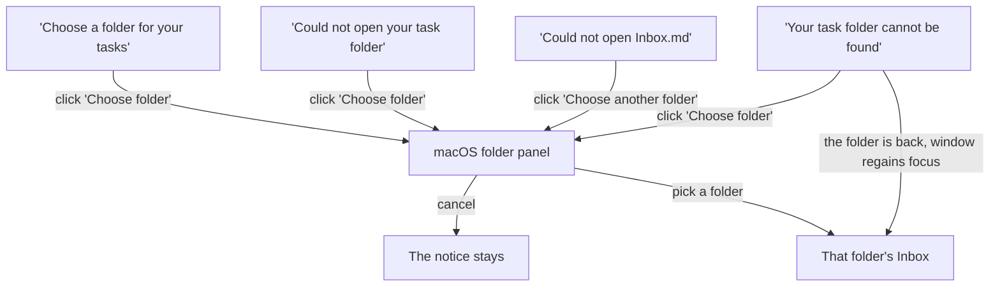

# Choose the task folder

The app keeps tasks in a folder the person picks. With no folder chosen, the window shows a notice and one button that opens the macOS folder panel. After a pick, the window shows that folder's Inbox. The choice is remembered across launches. When the choice or the file cannot be opened, or the folder has gone, a notice says why and offers the folder panel again.

## Use cases

- As a person who opens the app for the first time, I pick the folder where my task files live, or make a new one in the panel.
- As a person who relaunches the app, I see my Inbox at once, with no folder panel.
- As a person whose file cannot be opened, I read the reason and pick another folder.

## Sub-features

- `folder-ask` shows the notice `Choose a folder for your tasks` with the button `Choose folder` when no folder is chosen. No file is read. The header has no `New task` button. The sidebar count is blank.
- `folder-pick` opens the folder panel from the button and shows the picked folder's Inbox.
- `folder-pick-empty` shows `Inbox zero` and the `New task` button after a pick of a folder with no `Inbox.md`. The folder gains no file.
- `folder-cancel` leaves the notice in place when the panel is cancelled.
- `folder-remembered` opens the same folder on the next launch with no panel.
- `folder-forgotten` asks again, with the `folder-ask` notice, when the remembered folder was deleted before the launch.
- `folder-recall-error` shows the notice `Could not open your task folder`, the reason, and the button `Choose folder` when the stored choice cannot be read. The window still appears.
- `folder-choose-another` opens the same panel from the button `Choose another folder` on the notice `Could not open Inbox.md`.
- `folder-gone` shows the notice `Your task folder cannot be found` with the button `Choose folder` when the chosen folder is no longer there at the window's next focus. It is moved, renamed, deleted, or on a disk that is not connected. The list does not show `Inbox zero`. The header has no `New task` button, the sidebar count is blank and the Dock badge is removed. Nothing is written and the folder is not made again.
- `folder-gone-at-launch` shows the same notice when the folder the app opens at launch is not there.
- `folder-gone-pick` opens the folder panel from the button on that notice and shows the picked folder's Inbox.
- `folder-gone-returns` shows the Inbox again when the folder is back in its place and the window regains focus.
- `folder-from-environment` opens the folder named by `PLAINTASK_ROOT` with no panel and no stored choice.

## How to get to it (user POV)

- Launch the app with no folder chosen. The notice and the button `Choose folder` fill the list area.
- Click `Choose folder` on the notice `Choose a folder for your tasks`.
- Click `Choose folder` on the notice `Could not open your task folder`.
- Click `Choose another folder` on the notice `Could not open Inbox.md`.
- Click `Choose folder` on the notice `Your task folder cannot be found`.
- Put a folder that has gone back in its place, then switch to another app and back.
- In the folder panel, pick a folder, or create one with the panel's own new-folder control, or cancel.
- Launch with `PLAINTASK_ROOT` set to a folder path to skip the panel.

The buttons have no key of their own. No key opens the folder panel.

## Driving it with control-desktop

Preconditions:

- Page tier: `.verify/baseline.md` holds the baseline file. The README section "Baseline preconditions" has the command that writes it.
- Page tier: a run has one task folder. `launch --no-folder --inbox .verify/baseline.md` makes it folder A, not chosen yet. `launch --no-folder --no-inbox` makes it folder B, not chosen yet.
- Page tier: the helper answers the folder request. After `panel pick` it returns the run's folder. After `panel cancel` it returns nothing. No panel is drawn.
- Page tier: `control-desktop external --move-folder` moves the run's folder away, as a move in Finder does. `control-desktop external --return-folder` puts it back. A pick while the folder is away also puts it back: a run has one folder, so the pick stands for a person who picks the folder at its new place.
- Page tier: `control-desktop doctor` ends with `healthy` before the first drive command of a run.
- Real window: the app instance was started by this run under a test identifier, with no stored folder choice, and without `PLAINTASK_ROOT`.
- Real window: folder A is disposable and holds the baseline file. Folder B is disposable and empty.
- Real window: the app window is frontmost for every step that uses the folder panel.

- **`folder-ask`.** Action: launch the app. Result: a status region shows the bold line `Choose a folder for your tasks`, the line `Plaintask keeps them there as plain Markdown files.` and the button `Choose folder`. The header shows `Inbox` and no `New task` button. `[data-badge="inbox"]` is blank. File: folder A's `Inbox.md` is unchanged. Handle: button `Choose folder` inside `[data-choose]`. Run `control-desktop launch --no-folder --inbox .verify/baseline.md`, then `control-desktop snapshot --save folder-ask`. The snapshot has the lines `folder: not chosen (the folder panel will pick)` and `sidebar badge: none`, the count `read_inbox 0`, the heading `Inbox`, a `status` with the two lines of the notice and `button "Choose folder"`, and no `button "New task N"`. Run `control-desktop wait --selector '[data-choose] button'`. It exits 0. Run `control-desktop wait --selector '[data-head] button' --gone --timeout 500`. It exits 0. Run `control-desktop file | cmp - .verify/baseline.md`. It prints nothing and exits 0.
- **`folder-cancel`.** Action: click `Choose folder`, then cancel the panel. Result: a panel titled `Choose a folder for your tasks` opens and closes. The notice `Choose a folder for your tasks` is still shown. File: unchanged. Handle: button `Choose folder`; the panel's own Cancel button. Real window only: follow the checking-desktop-app skill. Page-tier check, on the `folder-ask` run: run `control-desktop panel cancel`, then `control-desktop click --role button --name "Choose folder"`, then `control-desktop wait --text "Choose a folder for your tasks" --timeout 500`, then `control-desktop snapshot --save folder-cancel`. The snapshot has `folder: not chosen (the folder panel will cancel)`, `choose_folder 1`, `read_inbox 0` and the same notice. `control-desktop file | cmp - .verify/baseline.md` prints nothing. This shows that the page asks for a folder once and keeps the notice when it gets none. It does not show the panel, its title or its Cancel button.
- **`folder-pick`.** Action: click `Choose folder`, then pick folder A. Result: the notice is replaced by the rows `Buy milk`, `Call mum`, `Water plants`. The header gains `New task`. The sidebar count is `3`. File: folder A's `Inbox.md` is byte for byte the baseline file. Handle: button `Choose folder`; in the panel, Command-Shift-G takes a typed path. Real window only: follow the checking-desktop-app skill. Page-tier check, on the `folder-ask` run: run `control-desktop panel pick`, then `control-desktop click --role button --name "Choose folder"`. Run `control-desktop wait --selector '[data-list] li:nth-child(1)[data-row="0:Buy milk"]'`, `control-desktop wait --selector '[data-list] li:nth-child(2)[data-row="0:Call mum"]'` and `control-desktop wait --selector '[data-list] li:nth-child(3)[data-row="0:Water plants"]'`. Each exits 0. Run `control-desktop wait --selector '[data-choose]' --gone --timeout 500` and `control-desktop wait --role button --name "New task N"`. Each exits 0. Run `control-desktop snapshot --save folder-pick`. It has `folder: chosen`, `sidebar badge: 3`, `read_inbox 1` and `write_inbox 0`. `control-desktop file | cmp - .verify/baseline.md` prints nothing. This shows that the page reads and draws the folder it is given. It does not show the panel or the pick inside it.
- **`folder-pick-empty`.** Action: from the `folder-ask` state, click `Choose folder`, then pick folder B. Result: the list shows `Inbox zero`. No button remains inside `[data-choose]`. The header button reads `New task` with the key hint `N`. File: folder B holds no `Inbox.md`. Handle: status region with the bold line `Inbox zero`. Real window only: follow the checking-desktop-app skill. Page-tier check, on a new run: run `control-desktop launch --no-folder --no-inbox`, then `control-desktop click --role button --name "Choose folder"`. Run `control-desktop wait --text "Inbox zero"`, `control-desktop wait --selector '[data-choose]' --gone --timeout 500` and `control-desktop wait --role button --name "New task N"`. Each exits 0. Run `control-desktop snapshot --save folder-pick-empty`. It has `Inbox.md: absent`, `sidebar badge: none` and `write_inbox 0`. Run `control-desktop file`. It prints `Inbox.md is absent from` and the folder's path, and exits 3. This shows the page's part. It does not show the panel.
- **`folder-remembered`.** Action: after `folder-pick`, quit the app and launch it again. Result: the three rows show with no notice and no panel. File: folder A's `Inbox.md` is unchanged. Handle: rows inside `[data-list]`. Real window only: follow the checking-desktop-app skill. Page-tier check, on the `folder-pick` run: run `control-desktop reload`. Run `control-desktop wait --selector '[data-list] li:nth-child(3)[data-row="0:Water plants"]'` and `control-desktop wait --selector '[data-choose]' --gone --timeout 500`. Each exits 0. Run `control-desktop snapshot --save folder-remembered`. It has `folder: chosen`, `choose_folder 0` and `read_inbox 1`. `control-desktop file | cmp - .verify/baseline.md` prints nothing. This shows that a page that is told a folder at load draws its Inbox and asks for no folder. It does not show the quit, the relaunch or the stored choice: the helper keeps the folder chosen across `reload`.
- **`folder-forgotten`.** Action: after `folder-pick`, quit the app, delete the picked folder, and launch again. Result: the notice `Choose a folder for your tasks` shows. No error notice shows. File: none; the folder is gone. Handle: status region inside `[data-list]`. Real window only: follow the checking-desktop-app skill. The page tier has no check for this: the helper has no command that makes a chosen folder not chosen at the next load. The page's part is the notice it draws when it is told no folder, which `folder-ask` covers.
- **`folder-recall-error`.** Action: make the stored folder choice unreadable, then launch. Result: the window appears with the bold line `Could not open your task folder`, a reason that starts `Could not read the folder choice in`, and the button `Choose folder`. File: unchanged. Handle: status region inside `[data-list]`; button inside `[data-choose]`. Real window only: follow the checking-desktop-app skill. Page-tier check, on the `folder-pick` run: run `control-desktop fail folder "Could not read the folder choice in /tmp/task-folder.bookmark: Permission denied (os error 13)"`, then `control-desktop reload`. Run `control-desktop wait --text "Could not open your task folder"` and `control-desktop wait --selector '[data-choose] button'`. Each exits 0. Run `control-desktop snapshot --save folder-recall-error`. It has `read_inbox 0`, the heading `Inbox`, no `button "New task N"`, and a `status` with the bold line, the reason given to `fail`, and `button "Choose folder"`. `control-desktop file | cmp - .verify/baseline.md` prints nothing. Then run `control-desktop click --role button --name "Choose folder"` and `control-desktop wait --selector '[data-list] li:nth-child(3)[data-row="0:Water plants"]'`. It exits 0: the button on this notice leads to the Inbox. This shows that the page draws the notice with the reason it is given. It does not show a stored choice that cannot be read, or the reason the app writes: the reason here is the text given to `fail`.
- **`folder-choose-another`.** Action: reach the notice `Could not open Inbox.md` (see `inbox-read-error` in [View the Inbox](./view-inbox.md)), click `Choose another folder`, then pick folder A. Result: the panel opens. After the pick the three baseline rows show. File: the unreadable file is byte for byte what it was. Folder A's `Inbox.md` is unchanged. Handle: button `Choose another folder` inside `[data-choose]`. Real window only: follow the checking-desktop-app skill. Page-tier check, on a new run: run `control-desktop launch --inbox .verify/baseline.md`, then `control-desktop fail read "Inbox.md is not UTF-8 text, so Plaintask will not change it."`, then `control-desktop reload`, then `control-desktop wait --text "Could not open Inbox.md"`. Run `control-desktop fail read --off`, then `control-desktop click --role button --name "Choose another folder"`. Run `control-desktop wait --selector '[data-list] li:nth-child(1)[data-row="0:Buy milk"]'`, `control-desktop wait --selector '[data-list] li:nth-child(2)[data-row="0:Call mum"]'` and `control-desktop wait --selector '[data-list] li:nth-child(3)[data-row="0:Water plants"]'`. Each exits 0. Run `control-desktop wait --selector '[data-choose]' --gone --timeout 500`. It exits 0. Run `control-desktop snapshot --save folder-choose-another`. It has `choose_folder 1` and `write_inbox 0`. `control-desktop file | cmp - .verify/baseline.md` prints nothing. This shows that the button asks for a folder and that the page then reads and draws it. It does not show the panel or a second folder: a page-tier run has one folder, so the read failure is turned off before the click.
- **`folder-gone`.** Action: with the baseline rows showing, move the task folder to another place from outside the app, then make the window regain focus. Result: a status region shows the bold line `Your task folder cannot be found`, the line `It may have been moved, renamed or deleted, or its disk is not connected.` and the button `Choose folder`. `Inbox zero` does not show. The header has no `New task` button and `N` opens no form. `[data-badge="inbox"]` is blank. The Dock icon has no badge. File: the moved folder's `Inbox.md` is byte for byte the baseline file. No folder is made at the old path. Handle: status region inside `[data-list]`; button `Choose folder` inside `[data-choose]`. Real window only: follow the checking-desktop-app skill. Page-tier check: run `control-desktop launch --inbox .verify/baseline.md`, then `control-desktop external --move-folder`, then `control-desktop wait --text "Buy milk"`. It exits 0: the rows stay until the focus change. Run `control-desktop refocus`. Run `control-desktop wait --text "Your task folder cannot be found"`, `control-desktop wait --role button --name "Choose folder"`, `control-desktop wait --text "Inbox zero" --gone --timeout 500` and `control-desktop wait --selector '[data-head] button' --gone --timeout 500`. Each exits 0. Run `control-desktop press n`, then `control-desktop wait --role textbox --name "Task" --gone --timeout 500`. It exits 0. Run `control-desktop snapshot --save folder-gone`. Its `folder:` line ends `(gone)`. It has `Inbox.md: absent`, `sidebar badge: none`, `dock badge: 0`, `write_inbox 0`, and a `status` with the two lines of the notice and `button "Choose folder"`. Run `control-desktop file`. It prints `Inbox.md is absent from` and the folder's path, and exits 3: nothing was made at the old path. This shows what the page draws when it is told the folder is gone. It does not show that the app tells a moved, renamed, deleted or unmounted folder apart from an empty one. `pnpm --filter @plaintask/desktop check:rust` covers that for a deleted folder.
- **`folder-gone-returns`.** Action: with the notice `Your task folder cannot be found` showing, move the folder back to its place, then make the window regain focus. Result: the three baseline rows show. The header has the `New task` button. The sidebar count and the Dock badge read `3`. No folder panel opens. File: byte for byte the baseline file. Handle: rows inside `[data-list]`. Real window only: follow the checking-desktop-app skill. Page-tier check, on the `folder-gone` run: run `control-desktop external --return-folder`, then `control-desktop refocus`. Run `control-desktop wait --selector '[data-list] li:nth-child(3)[data-row="0:Water plants"]'`, `control-desktop wait --role button --name "New task N"` and `control-desktop wait --selector '[data-choose]' --gone --timeout 500`. Each exits 0. Run `control-desktop snapshot --save folder-gone-returns`. It has `sidebar badge: 3`, `dock badge: 3`, `choose_folder 0` and `write_inbox 0`. `control-desktop file | cmp - .verify/baseline.md` prints nothing. This shows that the page reads the folder again on focus and draws the Inbox when the read succeeds. It does not show a real folder that is moved back, or a disk that is connected again.
- **`folder-gone-pick`.** Action: with the notice `Your task folder cannot be found` showing, click `Choose folder`, then pick the folder at its new place. Result: the panel opens. After the pick the three baseline rows show and the notice is gone. File: byte for byte the baseline file. Handle: button `Choose folder` inside `[data-choose]`. Real window only: follow the checking-desktop-app skill. Page-tier check, on the `folder-gone-returns` run: run `control-desktop external --move-folder`, then `control-desktop refocus`, then `control-desktop wait --text "Your task folder cannot be found"`. Run `control-desktop click --role button --name "Choose folder"`. Run `control-desktop wait --selector '[data-list] li:nth-child(1)[data-row="0:Buy milk"]'`, `control-desktop wait --selector '[data-list] li:nth-child(3)[data-row="0:Water plants"]'` and `control-desktop wait --selector '[data-choose]' --gone --timeout 500`. Each exits 0. Run `control-desktop snapshot --save folder-gone-pick`. It has `choose_folder 1`, `sidebar badge: 3` and `write_inbox 0`. `control-desktop file | cmp - .verify/baseline.md` prints nothing. This shows that the button asks for a folder and that the page then reads and draws it. It does not show the panel or a pick of another path: the helper puts the run's one folder back when it answers the pick.
- **`folder-gone-at-launch`.** Action: launch with `PLAINTASK_ROOT` set to a path where no folder exists. Result: the notice `Your task folder cannot be found` with the button `Choose folder`. `Inbox zero` does not show. No folder is made at that path. File: none. Handle: status region inside `[data-list]`. Real window only: follow the checking-desktop-app skill. Page-tier check, on the `folder-gone-pick` run: run `control-desktop external --move-folder`, then `control-desktop reload`. Run `control-desktop wait --text "Your task folder cannot be found"`, `control-desktop wait --text "Inbox zero" --gone --timeout 500` and `control-desktop wait --selector '[data-head] button' --gone --timeout 500`. Each exits 0. Run `control-desktop snapshot --save folder-gone-at-launch`. Its `folder:` line ends `(gone)`. It has `read_inbox 1`, `write_inbox 0`, `set_badge 0` and `sidebar badge: none`. Run `control-desktop file`. It exits 3. This shows what the page draws when the folder it is told at load is gone. It does not show `PLAINTASK_ROOT`, or what a remembered folder that was deleted leads to: see `folder-forgotten`.
- **`folder-from-environment`.** Action: launch with `PLAINTASK_ROOT` set to folder A. Result: the three rows show with no notice and no panel. File: unchanged. Handle: rows inside `[data-list]`. Real window only: follow the checking-desktop-app skill. The page tier has no check for this: the page never sees `PLAINTASK_ROOT`. A launch with a folder already chosen (`control-desktop launch --inbox .verify/baseline.md`) draws the same three rows and does not show where the folder came from.

## Gotchas

- The folder panel is a system panel. Input sent to a window that is not frontmost does not operate it. It needs a real mouse or full-screen control.
- The page tests in headless Chrome replace the panel with a fixed answer. They prove the notices and the buttons. They do not cover the panel, the stored choice or the sandbox.
- A build under the identifier `com.airshiplabs.plaintask` shares its stored folder choice with the installed app. A pick in that build changes the folder the installed app opens.
- `PLAINTASK_ROOT` takes precedence over a stored choice on every launch. A run that sets it cannot prove `folder-ask`, `folder-remembered` or `folder-forgotten`.
- While an Inbox is shown, the window has no control that changes the folder. The buttons exist only on the four notices.
- A folder deleted while the app is closed leads to `folder-ask` at the next launch. A folder that goes while the app is open leads to `Your task folder cannot be found`. Neither shows `Could not open your task folder`.
- An ad-hoc-signed rebuild kept the remembered folder in the hand check recorded in `apps/desktop/README.md`. A changed signature can make macOS refuse the stored choice, which leads to `folder-ask`.
- While a notice is shown, `N`, `j`, `k` and the arrow keys do nothing. A window focus change rereads the folder under `Could not open Inbox.md` and `Your task folder cannot be found`. It reads nothing under `Choose a folder for your tasks` and `Could not open your task folder`.
- A folder with no `Inbox.md` shows `Inbox zero`. A folder that is not there shows `Your task folder cannot be found`. `control-desktop external --remove` makes the first and `control-desktop external --move-folder` makes the second.
- While the folder is moved away, `control-desktop external --append`, `--from` and `--remove` are refused. Run `control-desktop external --return-folder` first.
- In the page tier, `fail folder` changes what the page is told at load. It does not change the folder request: a click on `Choose folder` while `fail folder` is on still returns the folder.
- In the page tier, the snapshot line `dock badge` keeps its last count across `reload`. After a `reload` that ends on a notice it can read `3` while `set_badge 0` shows that the page sent no count since the load.
