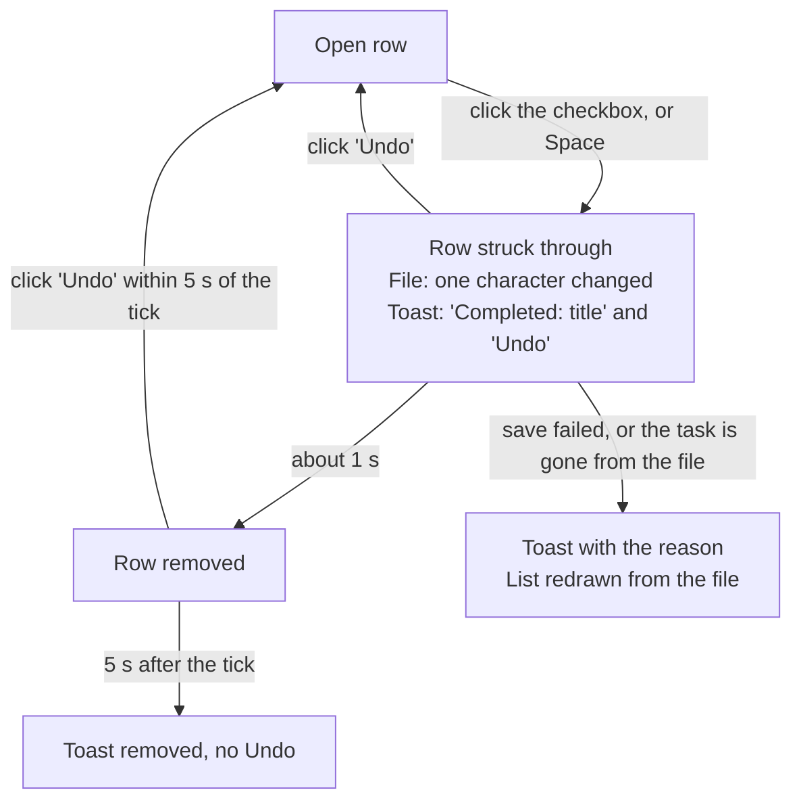

# Complete a task and Undo

A person ticks a task by clicking its checkbox or pressing Space on its row. One character of `Inbox.md` changes at once, from `- [ ]` to `- [x]`. The row is struck through, folds away after about 1 s, and a toast `Completed: <title>` offers `Undo` for 5 s. Undo puts the row back in its place and restores the file exactly.

## Use cases

- As a person who finished a task, I tick it and it leaves the list.
- As a person who ticked the wrong task, I press `Undo` and the task is back where it was.
- As a person who works from the keyboard, I tick with Space and the keyboard moves to the next row.

## Sub-features

- `complete-click` ticks a task on a click of its checkbox: the row is struck through, the checkbox reads checked, the toast shows, the sidebar count and the Dock badge drop at once, and the file changes at once.
- `complete-space` ticks the focused row on Space.
- `complete-one-character` changes one character of the file. Line endings, subtasks, headings and every other line stay as they were.
- `complete-row-leaves` removes the row about 1 s after the tick.
- `complete-last-task` shows `Inbox zero` after the last open task is ticked. The sidebar count is blank and the Dock badge is removed.
- `complete-focus-next` moves the keyboard to the row below the ticked row once it has folded away, or to the row above when there is none below.
- `complete-second-click-ignored` ignores a second click on a row that is leaving. The file is saved once.
- `complete-two-in-a-row` saves two tasks ticked one straight after the other. Two toasts show.
- `complete-duplicate-title` ticks the line that matches the row when two tasks share a title.
- `complete-keeps-other-lines` keeps lines another editor wrote since the app last read the file.
- `complete-task-gone` shows the toast `"<title>" is no longer in the file.` when another editor has deleted the task. The list is redrawn from the file and nothing is written.
- `complete-write-failure` shows a toast with the reason when the file cannot be saved. The row comes back unticked and the sidebar count is restored.
- `complete-long-title` strikes every line of a title that wraps. The toast cuts a long title short with `…` and keeps `Undo` on screen.
- `complete-read-only-file` shows a toast that ends `is read-only or locked, so Plaintask will not change it.` when `Inbox.md` is read-only or locked. The row comes back unticked and the file is not changed.
- `complete-hard-linked-file` shows a toast that names the hard link when `Inbox.md` has a second name. The row comes back unticked and neither name's text changes.
- `undo-restore` puts the task back between its neighbours on `Undo`, unticked. The file is byte for byte what it was. The sidebar count and the Dock badge are restored.
- `undo-once` unticks the task once on a double-click of `Undo`. The task is not ticked again.
- `undo-expires` removes the toast after 5 s. After that the app has no way to untick the task.
- `undo-toasts-stack` keeps every toast for its own 5 s. Three ticks in a row show three toasts, each with `Undo`.
- `undo-failure` shows a toast with the reason and redraws the list from the file when the Undo cannot be saved.

## How to get to it (user POV)

- Click the checkbox at the left of a row.
- Move the keyboard to a row with `j`, `k` or the arrow keys, then press Space.
- Click `Undo` on the toast `Completed: <title>`.

Undo has no key. Return on a focused row does not tick it; it opens the rename field.

## Driving it with control-desktop

Preconditions:

- The app instance was started by this run on a disposable task folder.
- The folder holds the baseline file unless the bullet names another file.
- The three rows `Buy milk`, `Call mum`, `Water plants` are showing. No toast is on screen. No rename field is open.
- Reset before each bullet. Run `printf '# Inbox\n\n- [ ] Buy milk\n- [ ] Call mum\n  - [ ] a subtask the app leaves alone\n- [x] Done already\n- [ ] Water plants\n' > "$(control-desktop file --path)"`, then `control-desktop reload`. The reload redraws the list from the file, removes every toast and leaves the keyboard on no row.
- A bullet that names another file gives its own `printf` in place of this one.
- Every proof in this section is from the page tier: the page in headless Chrome. A step the page tier cannot show says `real window only`.

- **`complete-click`.** Action: click the checkbox `Complete: Call mum`. Result, read within 0.5 s: that checkbox has `aria-checked="true"`. The row's title is struck through. A toast reads `Completed: Call mum` and holds the button `Undo`. `[data-badge="inbox"]` and the Dock badge read `2`. File: the baseline file with the line `- [ ] Call mum` changed to `- [x] Call mum`. Handle: checkbox `Complete: Call mum`. Run `control-desktop click --role checkbox --name "Complete: Call mum" --expect 'li[data-row="0:Call mum"][data-leaving]:has([role="checkbox"][aria-checked="true"]) .pt-task.is-done'`. It prints `clicked checkbox "Complete: Call mum"` and `then found:` with the selector: within 0.5 s of the click the checkbox is checked and the row has the struck-through style. Run `control-desktop snapshot`. It shows `text "Completed: Call mum"`, `button "Undo"`, `sidebar badge: 2`, `dock badge: 2` and `write_inbox 1`. The row can have left by the time of this snapshot, so the snapshot is not the proof of the checked box. Run `control-desktop file | cmp - <(printf '# Inbox\n\n- [ ] Buy milk\n- [x] Call mum\n  - [ ] a subtask the app leaves alone\n- [x] Done already\n- [ ] Water plants\n')`. It prints nothing and exits 0. For the picture of the struck-through title, reset, then run `control-desktop click --role checkbox --name "Complete: Call mum" --screenshot complete-click`. It prints `saved:` with the path and `taken within <n> ms of the click`. With `<n>` under 600 the picture shows the row ticked and struck through. The first pictures of a run can take longer. With `<n>` at 600 or more, reset and run the command again with a new name. The `dock badge:` line is the count the page asked for. The Dock icon itself is real window only: follow the checking-desktop-app skill.
- **`complete-space`.** Action: press `j` until the row `Buy milk` has the keyboard, then press Space. Result: the same as `complete-click`, for `Buy milk`. File: the baseline file with `- [ ] Buy milk` changed to `- [x] Buy milk`. Handle: the focused checkbox `Complete: Buy milk`. Run `control-desktop press j`. It prints `pressed j with the keyboard in the document, no element`. Run `control-desktop press Space`. It prints `pressed Space with the keyboard in checkbox "Complete: Buy milk"`. Run `control-desktop snapshot`. It shows `checkbox "Complete: Buy milk" [checked=true, focused]`, `text "Completed: Buy milk"`, `button "Undo"`, `sidebar badge: 2` and `dock badge: 2`. Run `control-desktop file | cmp - <(printf '# Inbox\n\n- [x] Buy milk\n- [ ] Call mum\n  - [ ] a subtask the app leaves alone\n- [x] Done already\n- [ ] Water plants\n')`. It prints nothing and exits 0. This proves Space in Chrome. Space in the real window is real window only: follow the checking-desktop-app skill.
- **`complete-one-character`.** Precondition: `Inbox.md` is the baseline file with every `\n` replaced by `\r\n`. Action: click `Complete: Call mum`. Result: as `complete-click`. File: the same length as before, and different at exactly one byte: the space between the brackets on the `Call mum` line is now `x`. The indented subtask line is unchanged. Handle: checkbox `Complete: Call mum`. Run `printf '# Inbox\r\n\r\n- [ ] Buy milk\r\n- [ ] Call mum\r\n  - [ ] a subtask the app leaves alone\r\n- [x] Done already\r\n- [ ] Water plants\r\n' > "$(control-desktop file --path)"`, then `control-desktop reload`. Run `control-desktop file > before.bin`. Run `control-desktop click --role checkbox --name "Complete: Call mum"`. Run `control-desktop snapshot`. It shows `Inbox.md: 123 bytes`, the same size as before, and `checkbox "Complete: Call mum" [checked=true, focused]`. Run `control-desktop file | cmp -l before.bin -`. It prints one line, `31  40 170`, and exits 1: byte 31 changed from a space to `x` and no other byte differs.
- **`complete-row-leaves`.** Action: click `Complete: Call mum` and wait until the row is gone. Result: `[data-list]` holds two rows, `Buy milk` and `Water plants`. File: as `complete-click`. Handle: `li[data-row]:not([data-leaving])`. Run `control-desktop click --role checkbox --name "Complete: Call mum"`, then `control-desktop wait --role checkbox --name "Complete: Call mum" --gone`. It prints `gone after <n> ms`. Run `control-desktop snapshot`. The list holds two items, `Complete: Buy milk` and `Complete: Water plants`. Run `control-desktop file | cmp - <(printf '# Inbox\n\n- [ ] Buy milk\n- [x] Call mum\n  - [ ] a subtask the app leaves alone\n- [x] Done already\n- [ ] Water plants\n')`. It prints nothing and exits 0.
- **`complete-last-task`.** Precondition: `Inbox.md` is `- [x] Done before` and `- [ ] Buy milk`, each with `\n`. Action: click `Complete: Buy milk`. Result: the list shows `Inbox zero`. `[data-badge="inbox"]` is blank. The Dock icon has no badge. File: `- [x] Done before\n- [x] Buy milk\n`. Handle: checkbox `Complete: Buy milk`; status region `Inbox zero`. Run `printf -- '- [x] Done before\n- [ ] Buy milk\n' > "$(control-desktop file --path)"`, then `control-desktop reload`. Run `control-desktop click --role checkbox --name "Complete: Buy milk"`, then `control-desktop wait --text "Inbox zero"`. It prints `found`. Run `control-desktop snapshot`. It shows `status` with `text "Inbox zero"`, `sidebar badge: none` and `dock badge: 0`. Run `control-desktop file | cmp - <(printf -- '- [x] Done before\n- [x] Buy milk\n')`. It prints nothing and exits 0. The `dock badge:` line is the count the page asked for. The Dock icon itself is real window only: follow the checking-desktop-app skill.
- **`complete-focus-next`.** Action: press `j` so `Buy milk` has the keyboard, press Space, and wait until the row is gone. Result: the checkbox `Complete: Call mum` has the keyboard. Then press `j` so `Water plants` has the keyboard, press Space, and wait. Result: `Complete: Call mum` has the keyboard again, because no row is below. File: the baseline file with `Buy milk` and `Water plants` ticked. Handle: the focused element's accessible name. Run `control-desktop press j`, `control-desktop press Space`, then `control-desktop wait --role checkbox --name "Complete: Buy milk" --gone`. Run `control-desktop snapshot`. It shows `focus: checkbox "Complete: Call mum"`. Run `control-desktop press j`. It prints `pressed j with the keyboard in checkbox "Complete: Call mum"`. Run `control-desktop press Space`, then `control-desktop wait --role checkbox --name "Complete: Water plants" --gone`. Run `control-desktop snapshot`. It shows `focus: checkbox "Complete: Call mum"`. Run `control-desktop file | cmp - <(printf '# Inbox\n\n- [x] Buy milk\n- [ ] Call mum\n  - [ ] a subtask the app leaves alone\n- [x] Done already\n- [x] Water plants\n')`. It prints nothing and exits 0.
- **`complete-second-click-ignored`.** Action: double-click `Complete: Buy milk`, which is two clicks in under 0.5 s. Result: one toast `Completed: Buy milk`. The row leaves once. File: the baseline file with `- [x] Buy milk`; the task is not unticked by the second click. Handle: checkbox `Complete: Buy milk`. Run `control-desktop click --role checkbox --name "Complete: Buy milk" --double`. It prints `double-clicked checkbox "Complete: Buy milk"`: two clicks at the same point in one command. Run `control-desktop snapshot`. It shows `write_inbox 1`, one `text "Completed: Buy milk"` and `checkbox "Complete: Buy milk" [checked=true, focused]`. Run `control-desktop file | cmp - <(printf '# Inbox\n\n- [x] Buy milk\n- [ ] Call mum\n  - [ ] a subtask the app leaves alone\n- [x] Done already\n- [ ] Water plants\n')`. It prints nothing and exits 0. Run `control-desktop wait --role checkbox --name "Complete: Buy milk" --gone`, then the same `cmp` again. It still prints nothing. Two separate `click` commands do not prove this: the second starts 0.5 s to 1.2 s after the first and can find the row gone.
- **`complete-two-in-a-row`.** Action: click `Complete: Buy milk`, then at once click `Complete: Water plants`. Result: two toasts, `Completed: Buy milk` and `Completed: Water plants`. One row remains, `Call mum`. File: the baseline file with both lines ticked and `- [ ] Call mum` unchanged. Handle: the two checkboxes; `[data-toasts] .pt-toast`. Run `control-desktop click --role checkbox --name "Complete: Buy milk"`, then `control-desktop click --role checkbox --name "Complete: Water plants"`, then `control-desktop wait --role checkbox --name "Complete: Water plants" --gone`. Run `control-desktop snapshot`. It shows `write_inbox 2`, `sidebar badge: 1`, one list item `Complete: Call mum`, and two toasts, `Completed: Buy milk` and `Completed: Water plants`, each with `button "Undo"`. Run `control-desktop file | cmp - <(printf '# Inbox\n\n- [x] Buy milk\n- [ ] Call mum\n  - [ ] a subtask the app leaves alone\n- [x] Done already\n- [x] Water plants\n')`. It prints nothing and exits 0.
- **`complete-duplicate-title`.** Precondition: `Inbox.md` is `- [ ] Water plants`, `- [ ] Call mum`, `- [ ] Water plants`, each with `\n`. Action: click the checkbox in `li[data-row="1:Water plants"]`, the third row. Result: the third row leaves. The first row stays. File: `- [ ] Water plants\n- [ ] Call mum\n- [x] Water plants\n`. Handle: `li[data-row="1:Water plants"]` and its checkbox. Run `printf -- '- [ ] Water plants\n- [ ] Call mum\n- [ ] Water plants\n' > "$(control-desktop file --path)"`, then `control-desktop reload`. Run `control-desktop click --selector 'li[data-row="1:Water plants"] .pt-check'`, then `control-desktop wait --selector 'li[data-row="1:Water plants"]' --gone`. Run `control-desktop snapshot`. The list holds `Complete: Water plants`, then `Complete: Call mum`. Run `control-desktop file | cmp - <(printf -- '- [ ] Water plants\n- [ ] Call mum\n- [x] Water plants\n')`. It prints nothing and exits 0.
- **`complete-keeps-other-lines`.** Action: with the baseline rows showing, replace `Inbox.md` from outside the app with `# Inbox\n\n- [ ] Something new\n- [ ] Buy milk\n`. Do not refocus the window. Click `Complete: Buy milk`. Result: the row `Buy milk` leaves. The list shows the file's open tasks: one row, `Something new`. `[data-badge="inbox"]` and the Dock badge read `1`. File: `# Inbox\n\n- [ ] Something new\n- [x] Buy milk\n`. Handle: checkbox `Complete: Buy milk`. Run `printf '# Inbox\n\n- [ ] Something new\n- [ ] Buy milk\n' > other.md`, then `control-desktop external --from other.md`. Do not run `refocus`. Run `control-desktop click --role checkbox --name "Complete: Buy milk"`. Run `control-desktop file | cmp - <(printf '# Inbox\n\n- [ ] Something new\n- [x] Buy milk\n')`. It prints nothing and exits 0. Run `control-desktop wait --role checkbox --name "Complete: Buy milk" --gone`. It prints `gone after <n> ms`. Run `control-desktop snapshot`. It shows one list item, `checkbox "Complete: Something new" [checked=false]`, with `sidebar badge: 1`, `dock badge: 1`, `write_inbox 1`, `text "Completed: Buy milk"` and `button "Undo"`. Here `<n>` is well under 1000: the file differs from the list by more than one row, so the list is drawn again and the ticked row goes without its fold. Run `control-desktop refocus`, then `control-desktop snapshot`. The list is the same.
- **`complete-task-gone`.** Action: with the baseline rows showing, replace `Inbox.md` from outside the app with `- [ ] Buy milk\n- [ ] Something new\n`. Do not refocus the window. Click `Complete: Call mum`. Result: a toast reads `"Call mum" is no longer in the file.`. The rows become `Buy milk` and `Something new`. File: `- [ ] Buy milk\n- [ ] Something new\n`, as written from outside. Handle: `[data-toasts] .pt-toast`; `li[data-row]:not([data-leaving])`. Run `printf -- '- [ ] Buy milk\n- [ ] Something new\n' > gone.md`, then `control-desktop external --from gone.md`. Do not run `refocus`. Run `control-desktop click --role checkbox --name "Complete: Call mum"`, then `control-desktop wait --text '"Call mum" is no longer in the file.'`. It prints `found`. Run `control-desktop snapshot`. The list holds `Complete: Buy milk` and `Complete: Something new`, and the line `write_inbox 0` shows that nothing was written. The toast `Completed: Call mum` with `Undo` shows too. Run `control-desktop file | cmp - <(printf -- '- [ ] Buy milk\n- [ ] Something new\n')`. It prints nothing and exits 0.
- **`complete-write-failure`.** Precondition: the file cannot be saved. In the real window that is a read-only task folder. In the page tier `fail write` gives the reason. Action: click `Complete: Buy milk`. Result: a toast shows the reason, which starts `Could not save` and names `Inbox.md`. The three rows show again and the first checkbox has `aria-checked="false"`. `[data-badge="inbox"]` reads `3`. File: byte for byte the baseline file. Handle: `[data-toasts] .pt-toast`; checkbox `Complete: Buy milk`. Run `control-desktop fail write "Could not save Inbox.md: Permission denied"`. Run `control-desktop click --role checkbox --name "Complete: Buy milk"`, then `control-desktop wait --text "Could not save Inbox.md: Permission denied"`. It prints `found`. Run `control-desktop snapshot`. It shows three list items, `checkbox "Complete: Buy milk" [checked=false]` and `sidebar badge: 3`. Run `control-desktop file | cmp - <(printf '# Inbox\n\n- [ ] Buy milk\n- [ ] Call mum\n  - [ ] a subtask the app leaves alone\n- [x] Done already\n- [ ] Water plants\n')`. It prints nothing and exits 0. Run `control-desktop fail write --off`. This proves that the page shows the reason it is given and restores the row. The reason a read-only folder gives is real window only: follow the checking-desktop-app skill, or run `pnpm --filter @plaintask/desktop check:rust` for the file layer.
- **`complete-long-title`.** Precondition: `.verify/long-title.md` from `inbox-long-title` in [View the Inbox](./view-inbox.md), and a run launched on it. Action: click the checkbox of the task whose title is 200 characters with no space, then click `Undo`. Result: all three lines of the title are struck through. The toast starts `Completed: Supercalifragilistic`, ends with `…`, and shows `Undo` at its right end inside the window. After `Undo` the four rows show. File: unchanged after the Undo. Handle: checkbox `Complete: <title>`; button `Undo`. Run `control-desktop launch --inbox .verify/long-title.md`. Run `T="$(printf 'Supercalifragilistic%.0s' 1 2 3 4 5 6 7 8 9 10)"`, then `control-desktop click --role checkbox --name "Complete: $T" --screenshot complete-long-title && control-desktop click --role button --name "Undo"`. The first command prints `saved:` and `taken within <n> ms of the click`. With `<n>` at 600 or more the row was already folding: run the line again with a new name until `<n>` is under 600. The first pictures of a run are the slow ones. The second command prints `clicked button "Undo" at 828,578`: the button's centre is inside the 880-wide window. The picture shows three struck lines and the toast with `…` before `Undo`. Run `control-desktop wait --selector '[data-list] li:nth-child(3)[data-row^="0:Supercalifragilistic"]'`. It exits 0. `control-desktop file | cmp - .verify/long-title.md` prints nothing and exits 0. The proof of the strike and of the `…` is the picture.
- **`complete-read-only-file`.** Action: make `Inbox.md` read-only from outside the app (`chmod 444`), then click `Complete: Buy milk`. Result: a toast shows a reason that ends `Inbox.md is read-only or locked, so Plaintask will not change it.`. The three rows show again and the first checkbox has `aria-checked="false"`. `[data-badge="inbox"]` reads `3`. File: byte for byte the baseline file. Handle: `[data-toasts] .pt-toast`; checkbox `Complete: Buy milk`. Real window only: follow the checking-desktop-app skill. Page-tier check: run `chmod 444 "$(control-desktop file --path)"`, then `control-desktop click --role checkbox --name "Complete: Buy milk"`, then `control-desktop wait --selector '[data-toasts] .pt-toast:nth-child(2)'`. It prints `found`: the second toast is the reason. Run `control-desktop snapshot | grep -e 'so Plaintask will not change it' -e 'Complete: Buy milk' -e 'sidebar badge'`. It prints `sidebar badge: 3`, `checkbox "Complete: Buy milk" [checked=false]` and a `text` line that ends `Inbox.md is read-only or locked, so Plaintask will not change it."`. Run `control-desktop file | cmp - .verify/baseline.md`. It prints nothing and exits 0. Run `chmod 644 "$(control-desktop file --path)"`. This shows that the page puts the reason in a toast and restores the row. The refusal here is the helper's, with the app's text. It does not show that the app refuses a read-only or locked file: `pnpm --filter @plaintask/desktop check:rust` covers that.
- **`complete-hard-linked-file`.** Action: give `Inbox.md` a hard link from outside the app (`ln`), then click `Complete: Buy milk`. Result: a toast shows a reason that ends `has a hard link, which a save would leave with the old text, so Plaintask will not change it. A symlink works.`. The three rows show again. File: both names hold the baseline file, byte for byte. Handle: `[data-toasts] .pt-toast`; checkbox `Complete: Buy milk`. Real window only: follow the checking-desktop-app skill. Page-tier check: run `L="$(dirname "$(control-desktop file --path)")/../hardlink.md"`, then `ln "$(control-desktop file --path)" "$L"`. Run `control-desktop click --role checkbox --name "Complete: Buy milk"`, then `control-desktop wait --selector '[data-toasts] .pt-toast:nth-child(2)'`. It prints `found`. Run `control-desktop snapshot | grep -e 'A symlink works' -e 'Complete: Buy milk' -e 'sidebar badge'`. It prints `sidebar badge: 3`, `checkbox "Complete: Buy milk" [checked=false]` and a `text` line that ends `has a hard link, which a save would leave with the old text, so Plaintask will not change it. A symlink works."`. Run `control-desktop file | cmp - .verify/baseline.md` and `cmp "$L" .verify/baseline.md`. Each prints nothing and exits 0. Run `rm "$L"`. This shows the page's part. The refusal here is the helper's, with the app's text. It does not show that the app refuses a hard-linked file: `pnpm --filter @plaintask/desktop check:rust` covers that.
- **`undo-restore`.** Action: click `Complete: Call mum`, then click `Undo` on the toast within 5 s. Wait 1.5 s more. Result: three rows in the order `Buy milk`, `Call mum`, `Water plants`. The checkbox `Complete: Call mum` has `aria-checked="false"`. `[data-badge="inbox"]` and the Dock badge read `3`. The row is still there after the wait. File: byte for byte the baseline file. Handle: button `Undo` inside `[data-toasts] .pt-toast`. Run `control-desktop click --role checkbox --name "Complete: Call mum" && control-desktop click --role button --name "Undo"`. It prints `clicked button "Undo"`. Run `control-desktop file | cmp - <(printf '# Inbox\n\n- [ ] Buy milk\n- [ ] Call mum\n  - [ ] a subtask the app leaves alone\n- [x] Done already\n- [ ] Water plants\n')`. It prints nothing and exits 0. Run `control-desktop wait --role checkbox --name "Complete: Call mum" --gone --timeout 1500`. It prints `was still there after 1500 ms` and exits 1: the row did not fold away. Run `control-desktop snapshot`. It shows the three list items in order, `checkbox "Complete: Call mum" [checked=false]`, `sidebar badge: 3`, `dock badge: 3`, `write_inbox 2` and no toast. To prove Undo after the row has left, reset, then run `control-desktop click --role checkbox --name "Complete: Call mum"`, `control-desktop wait --role checkbox --name "Complete: Call mum" --gone` and `control-desktop click --role button --name "Undo"`. The snapshot and the `cmp` give the same result. The `dock badge:` line is the count the page asked for. The Dock icon itself is real window only: follow the checking-desktop-app skill.
- **`undo-once`.** Action: click `Complete: Call mum`, then double-click `Undo` on the toast within 5 s. Wait 1.5 s more. Result: three rows in the order `Buy milk`, `Call mum`, `Water plants`. The checkbox `Complete: Call mum` has `aria-checked="false"`. No toast shows. The file was saved twice: the tick and one Undo. File: byte for byte the baseline file. Handle: button `Undo` inside `[data-toasts] .pt-toast`. Run `control-desktop click --role checkbox --name "Complete: Call mum" && control-desktop click --role button --name "Undo" --double`. It prints `double-clicked button "Undo"`. Run `control-desktop file | cmp - .verify/baseline.md`. It prints nothing and exits 0. Run `control-desktop wait --role checkbox --name "Complete: Call mum" --gone --timeout 1500`. It prints `was still there after 1500 ms` and exits 1: the row did not fold away again. Run `control-desktop snapshot`. It shows the three list items in order, `checkbox "Complete: Call mum" [checked=false]`, `sidebar badge: 3`, `dock badge: 3`, `write_inbox 2` and no toast. Run `control-desktop file | cmp - .verify/baseline.md` again. It prints nothing and exits 0.
- **`undo-expires`.** Action: click `Complete: Call mum` and wait 6 s. Result: no toast and no `Undo` button are on screen. Two rows remain. File: the baseline file with `- [x] Call mum`. Handle: `[data-toasts]` is empty. Run `control-desktop click --role checkbox --name "Complete: Call mum"`, then `control-desktop wait --role button --name "Undo" --gone`. It prints `gone after <n> ms`, with `<n>` under 5000. Run `control-desktop wait --selector '[data-toasts] .pt-toast' --gone --timeout 1000`. It prints `gone`. Run `control-desktop snapshot`. It shows two list items and no toast. Run `control-desktop file | cmp - <(printf '# Inbox\n\n- [ ] Buy milk\n- [x] Call mum\n  - [ ] a subtask the app leaves alone\n- [x] Done already\n- [ ] Water plants\n')`. It prints nothing and exits 0.
- **`undo-toasts-stack`.** Action: click `Complete: Water plants`, `Complete: Call mum` and `Complete: Buy milk` one after the other, the third within 5 s of the first. Result: three toasts show, one per task, each with `Undo`. File: the baseline file with all three lines ticked. Handle: `[data-toasts] .pt-toast`. Run `control-desktop click --role checkbox --name "Complete: Water plants" && control-desktop click --role checkbox --name "Complete: Call mum" && control-desktop click --role checkbox --name "Complete: Buy milk"`. Run `control-desktop wait --selector '[data-toasts] .pt-toast' --nth 3 --timeout 500`. It prints `found`. Run `control-desktop snapshot --save undo-toasts-stack`. It shows `Completed: Water plants`, `Completed: Call mum` and `Completed: Buy milk`, each followed by `button "Undo"`. Run `control-desktop file | cmp - <(printf '# Inbox\n\n- [x] Buy milk\n- [x] Call mum\n  - [ ] a subtask the app leaves alone\n- [x] Done already\n- [x] Water plants\n')`. It prints nothing and exits 0.
- **`undo-failure`.** Action: click `Complete: Call mum`. Within 5 s, replace `Inbox.md` from outside the app with `- [ ] Buy milk\n`, then click `Undo`. Result: a toast reads `"Call mum" is no longer in the file.`. The list shows one row, `Buy milk`. File: `- [ ] Buy milk\n`, as written from outside. Handle: button `Undo`; `[data-toasts] .pt-toast`. Run `printf -- '- [ ] Buy milk\n' > one.md` first. Run `control-desktop click --role checkbox --name "Complete: Call mum" && control-desktop external --from one.md && control-desktop click --role button --name "Undo"`. Run `control-desktop wait --text '"Call mum" is no longer in the file.'`. It prints `found`. Run `control-desktop snapshot`. The list holds one item, `Complete: Buy milk`, and `sidebar badge: 1`. Run `control-desktop file | cmp - <(printf -- '- [ ] Buy milk\n')`. It prints nothing and exits 0.

## Gotchas

- The `Undo` button is on screen for 5 s, counted from the tick. A step that takes longer than that between the tick and the `Undo` click finds no button.
- A ticked row stays in the page for about 1 s with `data-leaving`. In a long list, a ticked row that is scrolled away leaves the page at once. Selecting rows by index during that second selects the leaving row. Use `li[data-row]:not([data-leaving])`.
- A row that is leaving cannot be ticked again, cannot be renamed, and is skipped by `j`, `k` and the arrow keys.
- The file changes before the row folds away. Read the file right after the tick to prove that.
- The sidebar count drops at the tick, before the save finishes. A count alone is not proof of the file.
- The checkbox name stays `Complete: <title>` after the tick. Read `aria-checked`.
- When a tick fails, the toast `Completed: <title>` with `Undo` still shows next to the failure toast. A click on that `Undo` then runs against a task that is not ticked.
- Tick from the last row up when a recipe ticks several rows in a row. A row below a folding row moves up, and `click` refuses a target that is covered while it moves.
- The page tests stand in for Space with a click on the focused checkbox. `control-desktop press Space` sends a real Space key to Chrome. Space in the app's own web view is proved only in the real window.
- A real click on the checkbox of a row whose rename field is open first takes the keyboard out of the field. With a changed title, the rename is saved and the row is not ticked. With an unchanged or blank title, the field closes and the same click ticks the row. See `rename-blocks-tick` in [Rename a task](./rename-task.md).
- With a rename field open on `Buy milk` and its text changed, a click on `Complete: Call mum` saves the rename and ticks `Call mum`. The list then shows `Buy oat milk` and `Water plants`, the sidebar count is `2`, and the file has `- [ ] Buy oat milk` and `- [x] Call mum`. `tests/desktop-app.test.mjs` covers this.
- One `control-desktop` command takes 0.5 s to 1.2 s. Join commands that must land inside the 1 s fold or the 5 s toast with `&&` on one line. A `snapshot` or `screenshot` sent after a tick can still arrive after the row has left. Assert the ticked row in the click itself with `click --expect <css>`, and take its picture with `click --screenshot <name>`.
- A reason that holds a long folder path is cut short with `…` in the toast, so the end of the reason can be off the toast. The snapshot's `text` line holds the whole reason.
- Each bullet changes the file. Run the reset under Preconditions before the next bullet.
- `fail write` stays on across `reload`. Run `control-desktop fail write --off` after `complete-write-failure`.
