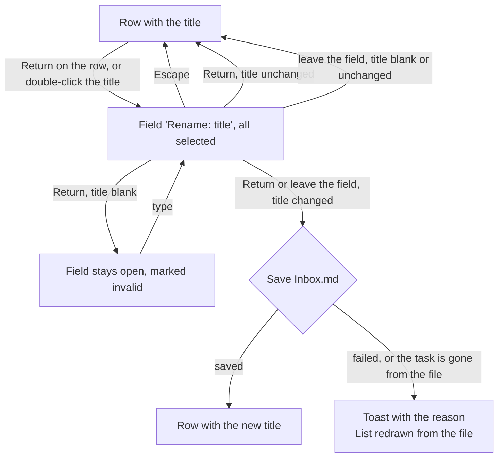

# Rename a task

A person opens a task's title in a field in its place, by Return on the focused row or a double-click on the title. Return or leaving the field saves the new title. Escape keeps the old one. Only the title's characters change in `Inbox.md`; the box, the tick, the spacing and the line ending stay. A blank title is not saved.

## Use cases

- As a person who mistyped a task, I fix its title in place.
- As a person who works from the keyboard, I press Return on a row, type and press Return again.

## Sub-features

- `rename-open-return` opens the field on Return on a focused row. The field holds the title, all selected, with the keyboard in it. The task is not ticked.
- `rename-open-double-click` opens the same field on a double-click on a title.
- `rename-save-return` saves the new title on Return. The row shows it, the keyboard returns to the row, the checkbox is named for the new title, the sidebar count is unchanged and no toast shows.
- `rename-save-blur` saves a changed title when the keyboard leaves the field.
- `rename-title-trimmed` writes the new title with no space around it.
- `rename-title-only` changes only the title's characters. The box, a tick, space around the old title, the line ending and every other line stay.
- `rename-whole-title` replaces everything after the box. Text such as `due:2026-11-28` and `#call` is part of the title and is replaced with it.
- `rename-cancel-escape` closes the field on Escape, shows the old title, writes nothing and returns the keyboard to the row.
- `rename-unchanged` closes the field on Return with the title unchanged and writes nothing.
- `rename-blank-return` keeps the field open on Return with a blank title, marks it invalid, shakes the row and writes nothing. Typing clears the mark.
- `rename-blank-blur` puts the old title back when the keyboard leaves a blank field. Nothing is written.
- `rename-keys-are-text` treats `j`, `k` and `n` typed in the field as letters.
- `rename-duplicate-source` renames the line that matches the row when two tasks share a title.
- `rename-to-existing-title` accepts a title another task already has. Both rows show.
- `rename-keeps-other-lines` keeps lines another editor wrote since the app last read the file, and shows them after the save.
- `rename-task-gone` shows the toast `"<title>" is no longer in the file.` when another editor has deleted the task. The list is redrawn from the file and nothing is written.
- `rename-write-failure` shows a toast with the reason when the file cannot be saved, and redraws the list from the file.
- `rename-blocks-tick` does not tick a row while its rename field is open.

## How to get to it (user POV)

- Move the keyboard to a row with `j`, `k` or the arrow keys, then press Return.
- Double-click a task's title with the mouse.
- In the open field: press Return to save, press Escape to cancel, or click elsewhere in the window to leave the field.

A double-click on the checkbox or on the empty part of a row does not open the field. The window has no rename button or menu.

## Driving it with control-desktop

Preconditions:

- The app instance was started by this run on a disposable task folder.
- The folder holds the baseline file unless the bullet names another file.
- The three rows `Buy milk`, `Call mum`, `Water plants` are showing. No rename field is open. The new-task form is closed.
- Reset before each bullet. Run `printf '# Inbox\n\n- [ ] Buy milk\n- [ ] Call mum\n  - [ ] a subtask the app leaves alone\n- [x] Done already\n- [ ] Water plants\n' > "$(control-desktop file --path)"`, then `control-desktop reload`. The reload redraws the list from the file, removes every toast and leaves the keyboard on no row.
- A bullet that names another file gives its own `printf` in place of this one.
- Every proof in this section is from the page tier: the page in headless Chrome. A step the page tier cannot show says `real window only`.

- **`rename-open-return`.** Action: press `j` twice so `Call mum` has the keyboard, then press Return. Result: a textbox named `Rename: Call mum` shows in place of the title, holds `Call mum` with all eight characters selected, and has the keyboard. The checkbox `Complete: Call mum` still has `aria-checked="false"`. No toast shows. File: byte for byte the baseline file. Handle: textbox `Rename: Call mum`. Run `control-desktop press j` twice, then `control-desktop press Enter`. It prints `pressed Enter with the keyboard in checkbox "Complete: Call mum"`. Run `control-desktop snapshot`. It shows `textbox "Rename: Call mum" [value="Call mum", focused]`, `checkbox "Complete: Call mum" [checked=false]`, `write_inbox 0` and no toast. Run `control-desktop type "Z"`, then `control-desktop snapshot`. It shows `value="Z"`: one key replaced all eight characters, so all were selected. Run `control-desktop press Escape`. Run `control-desktop file | cmp - <(printf '# Inbox\n\n- [ ] Buy milk\n- [ ] Call mum\n  - [ ] a subtask the app leaves alone\n- [x] Done already\n- [ ] Water plants\n')`. It prints nothing and exits 0.
- **`rename-open-double-click`.** Action: double-click the title `Water plants`. Result: a textbox named `Rename: Water plants` shows, holds `Water plants`, and has the keyboard. File: unchanged. Handle: `.pt-task__title` inside `li[data-row="0:Water plants"]`. Run `control-desktop click --selector 'li[data-row="0:Water plants"] .pt-task__title' --double`. It prints `double-clicked`. `control-desktop click --text "Water plants" --double` reaches the same element. Run `control-desktop snapshot`. It shows `textbox "Rename: Water plants" [value="Water plants", focused]` and `write_inbox 0`. Run `control-desktop file | cmp - <(printf '# Inbox\n\n- [ ] Buy milk\n- [ ] Call mum\n  - [ ] a subtask the app leaves alone\n- [x] Done already\n- [ ] Water plants\n')`. It prints nothing and exits 0. This proves a double-click in Chrome. A double-click in the real window is real window only: follow the checking-desktop-app skill.
- **`rename-save-return`.** Action: open the field on `Call mum` by Return, replace the text with `Call mum about Sunday`, press Return. Result: the rows read `Buy milk`, `Call mum about Sunday`, `Water plants`. The field is gone. The checkbox `Complete: Call mum about Sunday` has the keyboard. `[data-badge="inbox"]` reads `3`. No toast shows. File: the baseline file with the line `- [ ] Call mum` changed to `- [ ] Call mum about Sunday`. Handle: textbox `Rename: Call mum`; checkbox `Complete: Call mum about Sunday`. Run `control-desktop press j` twice, then `control-desktop press Enter`. Run `control-desktop fill --role textbox --name "Rename: Call mum" --value "Call mum about Sunday"`, then `control-desktop press Enter`. Run `control-desktop snapshot`. The list holds `Complete: Buy milk`, `Complete: Call mum about Sunday` and `Complete: Water plants`. It shows `focus: checkbox "Complete: Call mum about Sunday"`, `sidebar badge: 3`, `write_inbox 1`, no textbox and no toast. Run `control-desktop file | cmp - <(printf '# Inbox\n\n- [ ] Buy milk\n- [ ] Call mum about Sunday\n  - [ ] a subtask the app leaves alone\n- [x] Done already\n- [ ] Water plants\n')`. It prints nothing and exits 0.
- **`rename-save-blur`.** Action: open the field on `Buy milk`, replace the text with `Buy oat milk`, then click the heading `Inbox`. Result: the first row reads `Buy oat milk`. The field is gone. File: the baseline file with `- [ ] Buy milk` changed to `- [ ] Buy oat milk`. Handle: textbox `Rename: Buy milk`. Run `control-desktop press j`, then `control-desktop press Enter`. Run `control-desktop fill --role textbox --name "Rename: Buy milk" --value "Buy oat milk"`, then `control-desktop click --role heading --name "Inbox"`. Run `control-desktop snapshot`. The first list item is `Complete: Buy oat milk`. It shows `write_inbox 1`, `focus: the document, no element` and no textbox. Run `control-desktop file | cmp - <(printf '# Inbox\n\n- [ ] Buy oat milk\n- [ ] Call mum\n  - [ ] a subtask the app leaves alone\n- [x] Done already\n- [ ] Water plants\n')`. It prints nothing and exits 0. `refocus` does not take the keyboard out of the field, so leaving the field by switching apps is real window only: follow the checking-desktop-app skill.
- **`rename-title-trimmed`.** Action: open the field on `Call mum`, replace the text with two spaces, `Call mum about Sunday`, two spaces, then press Return. Result: the row reads `Call mum about Sunday`. File: the line is `- [ ] Call mum about Sunday` with no space after it. Handle: textbox `Rename: Call mum`. Run `control-desktop press j` twice, then `control-desktop press Enter`. Run `control-desktop fill --role textbox --name "Rename: Call mum" --value "  Call mum about Sunday  "`. Run `control-desktop snapshot`. It shows `value="  Call mum about Sunday  "`. Run `control-desktop press Enter`. Run `control-desktop file | cmp - <(printf '# Inbox\n\n- [ ] Buy milk\n- [ ] Call mum about Sunday\n  - [ ] a subtask the app leaves alone\n- [x] Done already\n- [ ] Water plants\n')`. It prints nothing and exits 0.
- **`rename-title-only`.** Precondition: `Inbox.md` is `# Inbox\r\n- [ ]   Spaced out  \r\n- [ ] Two\r\n`. Action: open the field on `Spaced out`, replace the text with `Tidy`, press Return. Result: the first row reads `Tidy`. File: `# Inbox\r\n- [ ]   Tidy  \r\n- [ ] Two\r\n`. Handle: textbox `Rename: Spaced out`. Run `printf '# Inbox\r\n- [ ]   Spaced out  \r\n- [ ] Two\r\n' > "$(control-desktop file --path)"`, then `control-desktop reload`. Run `control-desktop press j`, then `control-desktop press Enter`. Run `control-desktop fill --role textbox --name "Rename: Spaced out" --value "Tidy"`, then `control-desktop press Enter`. Run `control-desktop snapshot`. The first list item is `Complete: Tidy`. Run `control-desktop file | cmp - <(printf '# Inbox\r\n- [ ]   Tidy  \r\n- [ ] Two\r\n')`. It prints nothing and exits 0.
- **`rename-whole-title`.** Precondition: `Inbox.md` is `- [ ] Order floor tiles due:2026-11-28 #call\n`. Action: open the field, replace the text with `Order wall tiles`, press Return. Result: the row reads `Order wall tiles`. File: `- [ ] Order wall tiles\n`. Handle: textbox `Rename: Order floor tiles due:2026-11-28 #call`. Run `printf -- '- [ ] Order floor tiles due:2026-11-28 #call\n' > "$(control-desktop file --path)"`, then `control-desktop reload`. Run `control-desktop press j`, then `control-desktop press Enter`. Run `control-desktop fill --role textbox --name "Rename: Order floor tiles due:2026-11-28 #call" --value "Order wall tiles"`, then `control-desktop press Enter`. Run `control-desktop snapshot`. The one list item is `Complete: Order wall tiles`. Run `control-desktop file | cmp - <(printf -- '- [ ] Order wall tiles\n')`. It prints nothing and exits 0.
- **`rename-cancel-escape`.** Action: open the field on `Water plants`, replace the text with `Something else entirely`, press Escape. Result: the field is gone. The rows are the three baseline rows. The checkbox `Complete: Water plants` has the keyboard. File: unchanged. Handle: textbox `Rename: Water plants`. Run `control-desktop press j` three times, then `control-desktop press Enter`. Run `control-desktop fill --role textbox --name "Rename: Water plants" --value "Something else entirely"`, then `control-desktop press Escape`. Run `control-desktop snapshot`. It shows the three baseline list items, `focus: checkbox "Complete: Water plants"`, `write_inbox 0` and no textbox. Run `control-desktop file | cmp - <(printf '# Inbox\n\n- [ ] Buy milk\n- [ ] Call mum\n  - [ ] a subtask the app leaves alone\n- [x] Done already\n- [ ] Water plants\n')`. It prints nothing and exits 0.
- **`rename-unchanged`.** Action: open the field on `Buy milk` and press Return without typing. Result: the field is gone. The row reads `Buy milk`. File: unchanged. Handle: textbox `Rename: Buy milk`. Run `control-desktop press j`, then `control-desktop press Enter`. Run `control-desktop wait --role textbox --name "Rename: Buy milk"`. It prints `found`. Run `control-desktop press Enter`. Run `control-desktop snapshot`. It shows `checkbox "Complete: Buy milk" [checked=false, focused]`, `text "Buy milk"`, `write_inbox 0` and no textbox. Run `control-desktop file | cmp - <(printf '# Inbox\n\n- [ ] Buy milk\n- [ ] Call mum\n  - [ ] a subtask the app leaves alone\n- [x] Done already\n- [ ] Water plants\n')`. It prints nothing and exits 0.
- **`rename-blank-return`.** Action: open the field on `Buy milk`, replace the text with three spaces, press Return. Result: the field stays open with `aria-invalid="true"`. Then type `B`. Result: `aria-invalid` is gone. File: unchanged. Handle: textbox `Rename: Buy milk`. Run `control-desktop press j`, then `control-desktop press Enter`. Run `control-desktop fill --role textbox --name "Rename: Buy milk" --value "   "`, then `control-desktop press Enter`. Run `control-desktop wait --selector 'li[data-row="0:Buy milk"] .pt-task.is-shaking' --timeout 300`. It prints `found`. Run `control-desktop snapshot`. It shows `textbox "Rename: Buy milk" [value="   ", focused, invalid]` and `write_inbox 0`. Run `control-desktop type "B"`, then `control-desktop wait --selector 'input.app__rename[aria-invalid]' --gone --timeout 500`. It prints `gone`. Run `control-desktop file | cmp - <(printf '# Inbox\n\n- [ ] Buy milk\n- [ ] Call mum\n  - [ ] a subtask the app leaves alone\n- [x] Done already\n- [ ] Water plants\n')`. It prints nothing and exits 0. Run `control-desktop press Escape` to close the field.
- **`rename-blank-blur`.** Action: open the field on `Buy milk`, delete all the text, then click the heading `Inbox`. Result: the field is gone. The row reads `Buy milk`. File: unchanged. Handle: textbox `Rename: Buy milk`. Run `control-desktop press j`, then `control-desktop press Enter`. Run `control-desktop fill --role textbox --name "Rename: Buy milk" --value ""`, then `control-desktop click --role heading --name "Inbox"`. Run `control-desktop snapshot`. It shows `text "Buy milk"` in the first list item, `write_inbox 0` and no textbox. Run `control-desktop file | cmp - <(printf '# Inbox\n\n- [ ] Buy milk\n- [ ] Call mum\n  - [ ] a subtask the app leaves alone\n- [x] Done already\n- [ ] Water plants\n')`. It prints nothing and exits 0.
- **`rename-keys-are-text`.** Action: open the field on `Water plants`, delete the text, type `jkn`. Result: the field reads `jkn`. The keyboard stays in the field. The new-task form stays closed. Press Escape to finish. File: unchanged. Handle: textbox `Rename: Water plants`. Run `control-desktop press j` three times, then `control-desktop press Enter`. Run `control-desktop fill --role textbox --name "Rename: Water plants" --value ""`, then `control-desktop type "jkn"`. It prints `typed "jkn" with the keyboard in textbox "Rename: Water plants"`. Run `control-desktop snapshot`. It shows `textbox "Rename: Water plants" [value="jkn", focused]`. Run `control-desktop wait --role textbox --name "Task" --timeout 300`. It prints `did not appear after 300 ms` and exits 1: the new-task form is closed. Run `control-desktop press Escape`. Run `control-desktop file | cmp - <(printf '# Inbox\n\n- [ ] Buy milk\n- [ ] Call mum\n  - [ ] a subtask the app leaves alone\n- [x] Done already\n- [ ] Water plants\n')`. It prints nothing and exits 0.
- **`rename-duplicate-source`.** Precondition: `Inbox.md` is `- [ ] Water plants`, `- [ ] Call mum`, `- [ ] Water plants`, each with `\n`. Action: open the field on the third row, `li[data-row="1:Water plants"]`, replace the text with `Water the garden`, press Return. Result: the rows read `Water plants`, `Call mum`, `Water the garden`. File: `- [ ] Water plants\n- [ ] Call mum\n- [ ] Water the garden\n`. Handle: `li[data-row="1:Water plants"]`. Run `printf -- '- [ ] Water plants\n- [ ] Call mum\n- [ ] Water plants\n' > "$(control-desktop file --path)"`, then `control-desktop reload`. Run `control-desktop click --selector 'li[data-row="1:Water plants"] .pt-task__title' --double`, or `control-desktop press j` three times, then `control-desktop press Enter`. Run `control-desktop fill --role textbox --name "Rename: Water plants" --value "Water the garden"`, then `control-desktop press Enter`. Run `control-desktop snapshot`. The list holds `Complete: Water plants`, `Complete: Call mum` and `Complete: Water the garden`. Run `control-desktop file | cmp - <(printf -- '- [ ] Water plants\n- [ ] Call mum\n- [ ] Water the garden\n')`. It prints nothing and exits 0.
- **`rename-to-existing-title`.** Action: open the field on `Call mum`, replace the text with `Buy milk`, press Return. Result: the rows read `Buy milk`, `Buy milk`, `Water plants`. The second row is `li[data-row="1:Buy milk"]`. File: the baseline file with `- [ ] Call mum` changed to `- [ ] Buy milk`. Handle: `li[data-row="1:Buy milk"]`. Run `control-desktop press j` twice, then `control-desktop press Enter`. Run `control-desktop fill --role textbox --name "Rename: Call mum" --value "Buy milk"`, then `control-desktop press Enter`. Run `control-desktop wait --selector 'li[data-row="1:Buy milk"]'`. It prints `found`. Run `control-desktop snapshot`. The list holds `Complete: Buy milk`, `Complete: Buy milk` and `Complete: Water plants`. Run `control-desktop file | cmp - <(printf '# Inbox\n\n- [ ] Buy milk\n- [ ] Buy milk\n  - [ ] a subtask the app leaves alone\n- [x] Done already\n- [ ] Water plants\n')`. It prints nothing and exits 0.
- **`rename-keeps-other-lines`.** Action: with the baseline rows showing, replace `Inbox.md` from outside the app with `# Shopping\n- [ ] Buy milk\n- [ ] Typed in another editor\n`. Do not refocus the window. Open the field on `Buy milk`, replace the text with `Buy oat milk`, press Return. Result: the rows read `Buy oat milk`, `Typed in another editor`. File: `# Shopping\n- [ ] Buy oat milk\n- [ ] Typed in another editor\n`. Handle: textbox `Rename: Buy milk`. Run `printf '# Shopping\n- [ ] Buy milk\n- [ ] Typed in another editor\n' > shop.md`, then `control-desktop external --from shop.md`. Do not run `refocus`. Run `control-desktop press j`, then `control-desktop press Enter`. Run `control-desktop fill --role textbox --name "Rename: Buy milk" --value "Buy oat milk"`, then `control-desktop press Enter`. Run `control-desktop snapshot`. The list holds `Complete: Buy oat milk` and `Complete: Typed in another editor`. Run `control-desktop file | cmp - <(printf '# Shopping\n- [ ] Buy oat milk\n- [ ] Typed in another editor\n')`. It prints nothing and exits 0.
- **`rename-task-gone`.** Action: with the baseline rows showing, replace `Inbox.md` from outside the app with `- [ ] Typed in another editor\n`. Do not refocus the window. Open the field on `Buy milk`, replace the text with `Buy soya milk`, press Return. Result: a toast reads `"Buy milk" is no longer in the file.`. The list shows one row, `Typed in another editor`. File: `- [ ] Typed in another editor\n`, as written from outside. Handle: `[data-toasts] .pt-toast`. Run `printf -- '- [ ] Typed in another editor\n' > typed.md`, then `control-desktop external --from typed.md`. Do not run `refocus`. Run `control-desktop press j`, then `control-desktop press Enter`. Run `control-desktop fill --role textbox --name "Rename: Buy milk" --value "Buy soya milk"`, then `control-desktop press Enter`. Run `control-desktop wait --text '"Buy milk" is no longer in the file.'`. It prints `found`. Run `control-desktop snapshot`. The list holds one item, `Complete: Typed in another editor`, and the line `write_inbox 0` shows that nothing was written. Run `control-desktop file | cmp - <(printf -- '- [ ] Typed in another editor\n')`. It prints nothing and exits 0.
- **`rename-write-failure`.** Precondition: the file cannot be saved. In the real window that is a read-only task folder. In the page tier `fail write` gives the reason. Action: open the field on `Buy milk`, replace the text with `Buy oat milk`, press Return. Result: a toast shows the reason, which starts `Could not save` and names `Inbox.md`. The rows are the three baseline rows. File: byte for byte the baseline file. Handle: `[data-toasts] .pt-toast`. Run `control-desktop fail write "Could not save Inbox.md: Permission denied"`. Run `control-desktop press j`, then `control-desktop press Enter`. Run `control-desktop fill --role textbox --name "Rename: Buy milk" --value "Buy oat milk"`, then `control-desktop press Enter`. Run `control-desktop wait --text "Could not save Inbox.md: Permission denied"`. It prints `found`. Run `control-desktop snapshot`. It shows the three baseline list items and no textbox. Run `control-desktop file | cmp - <(printf '# Inbox\n\n- [ ] Buy milk\n- [ ] Call mum\n  - [ ] a subtask the app leaves alone\n- [x] Done already\n- [ ] Water plants\n')`. It prints nothing and exits 0. Run `control-desktop fail write --off`. This proves that the page shows the reason it is given and redraws the list. The reason a read-only folder gives is real window only: follow the checking-desktop-app skill, or run `pnpm --filter @plaintask/desktop check:rust` for the file layer.
- **`rename-blocks-tick`.** Action: open the field on `Buy milk`, replace the text with `Buy oat milk`, then click the checkbox of that row. Result: the click takes the keyboard out of the field, so the rename is saved and the row reads `Buy oat milk`. Its checkbox has `aria-checked="false"`. No toast shows. The row does not leave. File: the baseline file with `- [ ] Buy milk` changed to `- [ ] Buy oat milk`; no line reads `- [x]` except `Done already`. Handle: checkbox `Complete: Buy milk`, then `Complete: Buy oat milk`. Run `control-desktop press j`, then `control-desktop press Enter`. Run `control-desktop fill --role textbox --name "Rename: Buy milk" --value "Buy oat milk"`, then `control-desktop click --role checkbox --name "Complete: Buy milk"`. Run `control-desktop wait --role button --name "Undo" --timeout 300`. It prints `did not appear after 300 ms` and exits 1. Run `control-desktop wait --role checkbox --name "Complete: Buy oat milk" --gone --timeout 1500`. It prints `was still there after 1500 ms` and exits 1. Run `control-desktop snapshot`. It shows `checkbox "Complete: Buy oat milk" [checked=false]`, `write_inbox 1` and no toast. Run `control-desktop file | cmp - <(printf '# Inbox\n\n- [ ] Buy oat milk\n- [ ] Call mum\n  - [ ] a subtask the app leaves alone\n- [x] Done already\n- [ ] Water plants\n')`. It prints nothing and exits 0.

## Gotchas

- A synthetic double-click sent to the real window did not open the field. In the real window `rename-open-double-click` needs a real mouse on the frontmost window. `control-desktop click --double` opens the field in Chrome. Return on a focused row works from the keyboard.
- Return opens the field only when a row's checkbox has the keyboard. Return on the `New task` button opens the new-task form.
- Leaving the field saves. A click elsewhere in the window writes a changed title. Use Escape to leave without saving.
- While the field is open, `j`, `k`, `n`, the arrow keys and Space type into the field or move its caret. They do not move rows, open the form or tick.
- While the field is open, the window does not reread the file when it regains focus.
- A row that is leaving after a tick cannot be renamed. Wait until it is gone, or Undo first.
- The field's name is `Rename: <old title>`. It keeps that name while the text in it changes.
- The row's `data-row` value and its checkbox name change with the title. Target the row by the new title after a save.
- The page tests prove `rename-blocks-tick` with a click that does not move the keyboard. No person can make that click, and `control-desktop` cannot either. The bullet drives a real click.
- A real click on the checkbox of the row being renamed ticks the row when the field's text is unchanged or blank: the field closes first, then the click ticks. The toast `Completed: Buy milk` shows and the file reads `- [x] Buy milk`. `rename-blocks-tick` holds only when the text was changed.
- With a rename field open on `Buy milk` and its text changed, a click on `Complete: Call mum` saves the rename and ticks `Call mum`. The list then shows `Buy oat milk` and `Water plants`, the sidebar count is `2`, and the file has `- [ ] Buy oat milk` and `- [x] Call mum`. `tests/desktop-app.test.mjs` covers this.
- With no row focused, `j` moves the keyboard to the first row, and so does `k`. Reach the third row with `j` three times.
- `fill` clicks the field before it types. Use it only on a field that is already open.
- `fail write` stays on across `reload`. Run `control-desktop fail write --off` after `rename-write-failure`.
- A rename shows no toast when it succeeds. The proof is the row text and the file.
- The title is everything after the box. A rename of `Order floor tiles due:2026-11-28 #call` to `Order wall tiles` removes the date and the tag from the line.
