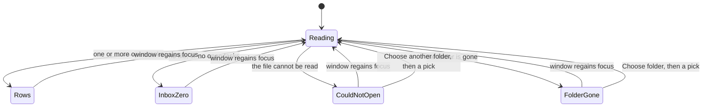

# View the Inbox

The window shows the open tasks of `Inbox.md` as rows, in file order. The sidebar item `Inbox` and the Dock icon show how many there are. With no open task the list shows `Inbox zero`. A file that cannot be read shows a notice with the reason, and the list comes back when the file can be read again. The app rereads the file each time the window regains focus.

## Use cases

- As a person who wants to know what is open, I read the rows, the sidebar count and the Dock badge.
- As a person who edits `Inbox.md` in another editor, I switch back to the app and see my change.
- As a person who keeps headings, notes and subtasks in the same file, I see only the tasks, and the rest of the file stays as I wrote it.

## Sub-features

- `inbox-list` shows one row per open task, in file order. A task is a line that starts at the left margin with `- [ ] ` and has a title. It is outside front matter, a closed code block and a closed HTML comment.
- `inbox-done-hidden` shows no row for a line that starts with `- [x] ` or `- [X] `.
- `inbox-not-tasks` shows no row for headings, prose, indented subtasks, lines inside front matter at the top of the file, `* [ ]`, `+ [ ]`, `1. [ ]`, `-[ ]`, `- []`, and a `- [ ] ` line with a blank title.
- `inbox-front-matter` treats `---` on the first line as the start of front matter. A first `---` with no closing `---` is not front matter: the lines after it are read as usual. A `---` line lower in the file is not front matter.
- `inbox-code-block` shows no row for a task line inside a fenced code block. The fence is ```` ``` ```` or `~~~`, and the block has a closing fence. The sidebar count leaves those lines out.
- `inbox-html-comment` shows no row for a task line inside an HTML comment that starts a line with `<!--` and ends with `-->`, on one line or on several.
- `inbox-unclosed-block` shows the task lines below a fence or a `<!--` that never closes.
- `inbox-title-as-written` shows the title as text, exactly as written. Markup such as `<b>` is shown as text. Text such as `due:2026-11-28` and `#call` is part of the title.
- `inbox-long-title` wraps a long title onto more lines inside its row. A run of characters with no space breaks where the row ends.
- `inbox-duplicate-titles` shows one row for each of two tasks with the same title.
- `inbox-header` shows the heading `Inbox` and the button `New task` with the key hint `N`.
- `inbox-empty-state` shows `Inbox zero` and `New tasks you capture land here first.` when the folder has no `Inbox.md` or the file has no open task. Nothing is written.
- `inbox-sidebar-count` shows the number of open tasks on the sidebar item `Inbox`. The count is blank at zero.
- `inbox-dock-badge` shows the same number on the Dock icon. The badge is absent at zero.
- `inbox-reread-on-focus` rereads `Inbox.md` when the window regains focus, and updates the rows, the sidebar count and the Dock badge.
- `inbox-read-error` shows the notice `Could not open Inbox.md`, the reason, and the button `Choose another folder` when the file cannot be read. The file is left as it is.
- `inbox-read-error-on-focus` shows the same notice when the file stops being readable while the app is open. The sidebar count goes blank and the Dock badge is removed.
- `inbox-read-recovers` shows the rows, the `New task` button and the counts again when the file can be read and the window regains focus. No folder pick is needed.
- `inbox-read-error-stays` keeps the same notice when the window regains focus and the file still cannot be read. The file is read again. The keyboard stays on the button `Choose another folder`.
- `inbox-no-page-menu` shows no menu on a right-click on the window. A right-click in a text field shows the usual text menu.
- `inbox-window-drag` moves the window when the top strip is dragged with a real mouse.



## How to get to it (user POV)

- Launch the app with a task folder chosen. The Inbox is the first and only view.
- Pick a folder from a folder notice. See [Choose the task folder](./choose-task-folder.md). The state `FolderGone` is `folder-gone` there.
- Switch to another app and back, or click the window, to make it reread the file.
- Look at the Dock icon for the badge.
- Right-click anywhere in the window.
- Drag the strip at the top of the window.

The sidebar item `Inbox` is the current item. Clicking it changes nothing.

## Driving it with control-desktop

Preconditions:

- `.verify/baseline.md` holds the baseline file. The README section "Baseline preconditions" has the command that writes it.
- The baseline run is `control-desktop launch --inbox .verify/baseline.md`. The bullets `inbox-list`, `inbox-done-hidden`, `inbox-header` and `inbox-sidebar-count` change nothing, so one baseline run serves all four.
- A bullet that names another file writes it under `.verify/` and launches a new run with `--inbox`, or replaces the file with `external --from` and then runs `refocus`.
- `control-desktop doctor` ends with `healthy` before the first drive command of a run.

- **`inbox-list`.** Action: launch on the baseline file. Result: `[data-list]` holds three rows in this order: `Buy milk`, `Call mum`, `Water plants`. Each row has a checkbox with `aria-checked="false"` named `Complete: <title>`. File: byte for byte the baseline file. Handle: `li[data-row]` inside `[data-list]`; checkbox `Complete: Buy milk`. Run `control-desktop launch --inbox .verify/baseline.md`. Run `control-desktop wait --selector '[data-list] li:nth-child(1)[data-row="0:Buy milk"]'`, `control-desktop wait --selector '[data-list] li:nth-child(2)[data-row="0:Call mum"]'` and `control-desktop wait --selector '[data-list] li:nth-child(3)[data-row="0:Water plants"]'`. Each exits 0. Run `control-desktop wait --selector '[data-list] li:nth-child(4)' --gone --timeout 500`. It exits 0: there is no fourth row. Run `control-desktop wait --selector '[data-list] [role="checkbox"][aria-checked="true"]' --gone --timeout 500`. It exits 0. Run `control-desktop snapshot --save inbox-list`. The `list` has three `listitem` entries with `checkbox "Complete: Buy milk" [checked=false]`, `checkbox "Complete: Call mum" [checked=false]` and `checkbox "Complete: Water plants" [checked=false]`, and `write_inbox 0`. Run `control-desktop file | cmp - .verify/baseline.md`. It prints nothing and exits 0.
- **`inbox-done-hidden`.** Action: launch on the baseline file. Result: no row reads `Done already`. File: unchanged. Handle: `.pt-task__title` texts inside `[data-list]`. On the baseline run, run `control-desktop wait --text "Done already" --gone --timeout 500`. It prints `gone after` and exits 0. Run `control-desktop wait --selector '[data-list] li:nth-child(4)' --gone --timeout 500`. It exits 0. `control-desktop file | cmp - .verify/baseline.md` prints nothing.
- **`inbox-not-tasks`.** Action: launch on a file with the lines `# Inbox`, `Notes about the tiler.`, `- [ ] Order floor tiles`, `  - [ ] Measure the hallway`, `* [ ] Star bullet`, `+ [ ] plus`, `1. [ ] numbered`, `-[ ] no space`, `- [] no gap`, and `- [ ] ` with a space after the bracket and no title. Result: one row, `Order floor tiles`. The sidebar count is `1`. File: unchanged. Handle: `.pt-task__title` texts. Run `printf '# Inbox\nNotes about the tiler.\n- [ ] Order floor tiles\n  - [ ] Measure the hallway\n* [ ] Star bullet\n+ [ ] plus\n1. [ ] numbered\n-[ ] no space\n- [] no gap\n- [ ] \n' > .verify/not-tasks.md`, then `control-desktop launch --inbox .verify/not-tasks.md`. Run `control-desktop wait --selector '[data-list] li:nth-child(1)[data-row="0:Order floor tiles"]'` and `control-desktop wait --selector '[data-list] li:nth-child(2)' --gone --timeout 500`. Each exits 0. Run `control-desktop snapshot --save inbox-not-tasks`. It has `sidebar badge: 1`, one `listitem` and `write_inbox 0`. Run `control-desktop file | cmp - .verify/not-tasks.md`. It prints nothing.
- **`inbox-front-matter`.** Action: launch on a file that starts `---`, `tags:`, `- [ ] a YAML item, not a task`, `---`, then `- [ ] Paint the ceiling`. Result: one row, `Paint the ceiling`. Then remove the second `---` and make the window regain focus. Result: two rows, `a YAML item, not a task` and `Paint the ceiling`. File: unchanged by the app in both cases. Handle: `.pt-task__title` texts. Run `printf -- '---\ntags:\n- [ ] a YAML item, not a task\n---\n- [ ] Paint the ceiling\n' > .verify/front-matter.md` and `printf -- '---\ntags:\n- [ ] a YAML item, not a task\n- [ ] Paint the ceiling\n' > .verify/front-matter-open.md`, then `control-desktop launch --inbox .verify/front-matter.md`. Run `control-desktop wait --selector '[data-list] li:nth-child(1)[data-row="0:Paint the ceiling"]'` and `control-desktop wait --selector '[data-list] li:nth-child(2)' --gone --timeout 500`. Each exits 0. `control-desktop file | cmp - .verify/front-matter.md` prints nothing. Run `control-desktop external --from .verify/front-matter-open.md`, then `control-desktop refocus`, then `control-desktop wait --selector '[data-list] li:nth-child(1)[data-row="0:a YAML item, not a task"]'`, `control-desktop wait --selector '[data-list] li:nth-child(2)[data-row="0:Paint the ceiling"]'` and `control-desktop wait --selector '[data-list] li:nth-child(3)' --gone --timeout 500`. Each exits 0. Run `control-desktop snapshot --save inbox-front-matter`. It has `sidebar badge: 2`, `dock badge: 2` and `write_inbox 0`. `control-desktop file | cmp - .verify/front-matter-open.md` prints nothing.
- **`inbox-code-block`.** Action: launch on a file with the lines `- [ ] Buy milk`, ```` ``` ````, `- [ ] Inside a backtick fence`, ```` ``` ````, `~~~markdown`, `- [ ] Inside a tilde fence`, `~~~`, `- [ ] Call mum`. Result: two rows, `Buy milk` and `Call mum`. The sidebar count is `2`. File: unchanged. Handle: `.pt-task__title` texts; `[data-badge="inbox"]`. Run ````printf '%s\n' '- [ ] Buy milk' '```' '- [ ] Inside a backtick fence' '```' '~~~markdown' '- [ ] Inside a tilde fence' '~~~' '- [ ] Call mum' > .verify/code-block.md````, then `control-desktop launch --inbox .verify/code-block.md`. Run `control-desktop wait --selector '[data-list] li:nth-child(1)[data-row="0:Buy milk"]'`, `control-desktop wait --selector '[data-list] li:nth-child(2)[data-row="0:Call mum"]'` and `control-desktop wait --selector '[data-list] li:nth-child(3)' --gone --timeout 500`. Each exits 0. Run `control-desktop wait --text "Inside a backtick fence" --gone --timeout 500` and `control-desktop wait --text "Inside a tilde fence" --gone --timeout 500`. Each exits 0. Run `control-desktop snapshot --save inbox-code-block`. It has `sidebar badge: 2`, `dock badge: 2` and `write_inbox 0`. `control-desktop file | cmp - .verify/code-block.md` prints nothing.
- **`inbox-html-comment`.** Action: launch on a file with the lines `- [ ] Buy milk`, `<!--`, `- [ ] Inside a comment`, `-->`, `<!-- - [ ] A one-line comment -->`, `- [ ] Call mum`. Result: two rows, `Buy milk` and `Call mum`. The sidebar count is `2`. File: unchanged. Handle: `.pt-task__title` texts; `[data-badge="inbox"]`. Run `printf '%s\n' '- [ ] Buy milk' '<!--' '- [ ] Inside a comment' '-->' '<!-- - [ ] A one-line comment -->' '- [ ] Call mum' > .verify/html-comment.md`, then `control-desktop launch --inbox .verify/html-comment.md`. Run `control-desktop wait --selector '[data-list] li:nth-child(1)[data-row="0:Buy milk"]'`, `control-desktop wait --selector '[data-list] li:nth-child(2)[data-row="0:Call mum"]'` and `control-desktop wait --selector '[data-list] li:nth-child(3)' --gone --timeout 500`. Each exits 0. Run `control-desktop wait --text "Inside a comment" --gone --timeout 500`. It exits 0. Run `control-desktop snapshot --save inbox-html-comment`. It has `sidebar badge: 2`, `dock badge: 2` and `write_inbox 0`. `control-desktop file | cmp - .verify/html-comment.md` prints nothing.
- **`inbox-unclosed-block`.** Action: launch on a file with the lines `- [ ] Buy milk`, ```` ``` ````, `- [ ] After a fence that never closes`, `<!--`, `- [ ] After a comment that never closes`. Result: three rows, `Buy milk`, `After a fence that never closes` and `After a comment that never closes`. The sidebar count is `3`. File: unchanged. Handle: `.pt-task__title` texts. Run ````printf '%s\n' '- [ ] Buy milk' '```' '- [ ] After a fence that never closes' '<!--' '- [ ] After a comment that never closes' > .verify/unclosed-block.md````, then `control-desktop launch --inbox .verify/unclosed-block.md`. Run `control-desktop wait --selector '[data-list] li:nth-child(1)[data-row="0:Buy milk"]'`, `control-desktop wait --selector '[data-list] li:nth-child(2)[data-row="0:After a fence that never closes"]'`, `control-desktop wait --selector '[data-list] li:nth-child(3)[data-row="0:After a comment that never closes"]'` and `control-desktop wait --selector '[data-list] li:nth-child(4)' --gone --timeout 500`. Each exits 0. Run `control-desktop snapshot | grep -x 'sidebar badge: 3'`. It prints the line. `control-desktop file | cmp - .verify/unclosed-block.md` prints nothing.
- **`inbox-title-as-written`.** Action: launch on a file with the lines `- [ ] Order floor tiles due:2026-11-28 #call` and `- [ ] <b>Paint</b> & "prime"`. Result: two rows whose visible text is exactly those two titles, angle brackets included. No bold text shows. The first checkbox is named `Complete: Order floor tiles due:2026-11-28 #call`. File: unchanged. Handle: `.pt-task__title` texts. Run `printf '%s\n' '- [ ] Order floor tiles due:2026-11-28 #call' '- [ ] <b>Paint</b> & "prime"' > .verify/titles.md`, then `control-desktop launch --inbox .verify/titles.md`. Run `control-desktop wait --text 'Order floor tiles due:2026-11-28 #call'` and `control-desktop wait --text '<b>Paint</b> & "prime"'`. Each exits 0. Run `control-desktop wait --selector '[data-list] b' --gone --timeout 500`. It exits 0: the list holds no `b` element. Run `control-desktop wait --role checkbox --name 'Complete: Order floor tiles due:2026-11-28 #call'` and `control-desktop wait --role checkbox --name 'Complete: <b>Paint</b> & "prime"'`. Each exits 0. Run `control-desktop wait --selector '[data-list] li:nth-child(3)' --gone --timeout 500`. It exits 0. Run `control-desktop screenshot inbox-title-as-written`. The picture shows the angle brackets as text. `control-desktop file | cmp - .verify/titles.md` prints nothing.
- **`inbox-long-title`.** Action: launch on a file with four tasks: `Buy milk`, a title of 189 characters in words, a title of 200 characters with no space, and `Water plants`. Result: four rows. Each long title is on three lines inside its row. No part of a title is outside the window. File: unchanged. Handle: `.pt-task__title` texts. Run `printf -- '- [ ] Buy milk\n- [ ] Ask the tiler whether the hallway floor needs a levelling compound before the tiles go down, and whether the skirting boards have to come off first or can stay where they are while he works\n- [ ] %s\n- [ ] Water plants\n' "$(printf 'Supercalifragilistic%.0s' 1 2 3 4 5 6 7 8 9 10)" > .verify/long-title.md`, then `control-desktop launch --inbox .verify/long-title.md`. Run `control-desktop wait --selector '[data-list] li:nth-child(4)[data-row="0:Water plants"]'` and `control-desktop wait --selector '[data-list] li:nth-child(5)' --gone --timeout 500`. Each exits 0. Run `control-desktop wait --text "$(printf 'Supercalifragilistic%.0s' 1 2 3 4 5 6 7 8 9 10)"`. It prints `found`. Run `control-desktop screenshot inbox-long-title`. The picture shows the second and third titles on three lines each, with the right end of every line inside the window, and `Water plants` below them. `control-desktop file | cmp - .verify/long-title.md` prints nothing. The proof of the wrap is the picture: no command of the helper measures a row.
- **`inbox-duplicate-titles`.** Action: launch on a file with the lines `- [ ] Water plants`, `- [ ] Call mum`, `- [ ] Water plants`. Result: three rows. The first is `li[data-row="0:Water plants"]` and the third is `li[data-row="1:Water plants"]`. The sidebar count is `3`. File: unchanged. Handle: the two `data-row` values. Run `printf '%s\n' '- [ ] Water plants' '- [ ] Call mum' '- [ ] Water plants' > .verify/duplicates.md`, then `control-desktop launch --inbox .verify/duplicates.md`. Run `control-desktop wait --selector '[data-list] li:nth-child(1)[data-row="0:Water plants"]'`, `control-desktop wait --selector '[data-list] li:nth-child(2)[data-row="0:Call mum"]'`, `control-desktop wait --selector '[data-list] li:nth-child(3)[data-row="1:Water plants"]'` and `control-desktop wait --selector '[data-list] li:nth-child(4)' --gone --timeout 500`. Each exits 0. Run `control-desktop snapshot | grep -x 'sidebar badge: 3'`. It prints the line. `control-desktop file | cmp - .verify/duplicates.md` prints nothing.
- **`inbox-header`.** Action: launch on the baseline file. Result: the heading reads `Inbox`. The header button's text is `New task` followed by `N`. File: unchanged. Handle: heading `Inbox`; button inside `[data-head]`. On the baseline run, run `control-desktop wait --role heading --name "Inbox"`, `control-desktop wait --role button --name "New task N"` and `control-desktop wait --selector '[data-head] button'`. Each exits 0. `control-desktop file | cmp - .verify/baseline.md` prints nothing.
- **`inbox-empty-state`.** Action: launch on a folder with no `Inbox.md`. Result: a status region shows the bold line `Inbox zero` and the line `New tasks you capture land here first.`. The heading reads `Inbox`. The sidebar count is blank. The Dock icon has no badge. File: the folder still has no `Inbox.md`. Handle: status region inside `[data-list]`. Run `control-desktop launch --no-inbox`. Run `control-desktop wait --text "Inbox zero"`, `control-desktop wait --text "New tasks you capture land here first."` and `control-desktop wait --role heading --name "Inbox"`. Each exits 0. Run `control-desktop snapshot --save inbox-empty-state`. It has `Inbox.md: absent`, `sidebar badge: none`, `dock badge: never set`, `write_inbox 0`, and a `status` that holds both lines. Run `control-desktop file`. It prints `Inbox.md is absent from` and the folder's path, and exits 3. The Dock icon itself is real window only; see `inbox-dock-badge`.
- **`inbox-sidebar-count`.** Action: launch on the baseline file. Result: `[data-badge="inbox"]` reads `3`. The done task is not counted. File: unchanged. Handle: `[data-badge="inbox"]`. On the baseline run, run `control-desktop snapshot | grep -x 'sidebar badge: 3'`. It prints the line and exits 0. The snapshot reads that line from `[data-badge="inbox"]`. Run `control-desktop wait --role button --name "Inbox 3"`. It exits 0: the count is part of the sidebar item's name. `control-desktop file | cmp - .verify/baseline.md` prints nothing.
- **`inbox-dock-badge`.** Action: launch on the baseline file and look at the Dock icon. Result: the badge reads `3`. Then launch on a folder with no `Inbox.md`. Result: the Dock icon has no badge. File: unchanged. Handle: the Plaintask Dock icon. Real window only: follow the checking-desktop-app skill. Page-tier check: on the baseline run, run `control-desktop snapshot | grep -x 'dock badge: 3'`. It prints the line. On a run from `control-desktop launch --no-inbox`, run `control-desktop snapshot | grep -x 'dock badge: never set'`. It prints the line. This shows the count the page sent for the Dock icon, and that it sent none at zero. It does not show the Dock icon.
- **`inbox-reread-on-focus`.** Action: with the baseline rows showing, append the line `- [ ] Typed in another editor` to `Inbox.md` from outside the app, then make the window regain focus. Result: a fourth row `Typed in another editor` shows last. The sidebar count and the Dock badge read `4`. File: the baseline file plus that one line; the app wrote nothing. Handle: `.pt-task__title` texts; `[data-badge="inbox"]`. On a baseline run, run `control-desktop external --append "- [ ] Typed in another editor"`, then `control-desktop wait --text "Typed in another editor" --gone --timeout 500`. It exits 0: the row does not show before the focus change. Run `control-desktop refocus`, then `control-desktop wait --selector '[data-list] li:nth-child(4)[data-row="0:Typed in another editor"]'` and `control-desktop wait --selector '[data-list] li:nth-child(5)' --gone --timeout 500`. Each exits 0. Run `control-desktop snapshot --save inbox-reread-on-focus`. It has `sidebar badge: 4`, `dock badge: 4`, `read_inbox 2` and `write_inbox 0`. Run `control-desktop file | cmp - <(printf '# Inbox\n\n- [ ] Buy milk\n- [ ] Call mum\n  - [ ] a subtask the app leaves alone\n- [x] Done already\n- [ ] Water plants\n- [ ] Typed in another editor\n')`. It prints nothing. `refocus` sends the page a focus event. A switch to another app and back is real window only.
- **`inbox-read-error`.** Action: launch on a folder whose `Inbox.md` holds bytes that are not UTF-8, for example `0xff 0xfe` followed by `- [ ] Buy milk`. Result: a status region shows the bold line `Could not open Inbox.md`, a reason that ends `is not UTF-8 text, so Plaintask will not change it.`, and the button `Choose another folder`. The header has no `New task` button. File: the same bytes as before. Handle: status region inside `[data-list]`; button inside `[data-choose]`. Real window only: follow the checking-desktop-app skill. Page-tier check: run `printf '\xff\xfe- [ ] Buy milk\n' > .verify/not-utf8.md`, then `control-desktop launch --inbox .verify/not-utf8.md`. Run `control-desktop wait --text "Could not open Inbox.md"`, `control-desktop wait --role button --name "Choose another folder"` and `control-desktop wait --selector '[data-head] button' --gone --timeout 500`. Each exits 0. Run `control-desktop snapshot --save inbox-read-error`. It has `sidebar badge: none`, `dock badge: never set`, `write_inbox 0`, and a `status` with the bold line, a reason that ends `Inbox.md is not UTF-8 text, so Plaintask will not change it.`, and the button. `control-desktop file | cmp - .verify/not-utf8.md` prints nothing. This shows that the page draws the notice with the reason it is given and writes nothing. The refusal here is the helper's, with the app's text. It does not show that the app refuses the bytes. For a reason of your own, run `control-desktop fail read "<message>"`, then `control-desktop reload`.
- **`inbox-read-error-on-focus`.** Action: with the baseline rows showing, replace `Inbox.md` with the non-UTF-8 bytes from outside the app, then make the window regain focus. Result: the notice `Could not open Inbox.md` replaces the rows. The sidebar count is blank. The Dock icon has no badge. File: the same bytes that were written from outside. Handle: status region inside `[data-list]`; `[data-badge="inbox"]`. Real window only: follow the checking-desktop-app skill. Page-tier check: on a baseline run, with `.verify/not-utf8.md` from `inbox-read-error`, run `control-desktop external --from .verify/not-utf8.md`, then `control-desktop refocus`. Run `control-desktop wait --text "Could not open Inbox.md"` and `control-desktop wait --selector '[data-list] li' --gone --timeout 500`. Each exits 0. Run `control-desktop snapshot --save inbox-read-error-on-focus`. It has `sidebar badge: none`, `dock badge: 0`, `write_inbox 0` and no `button "New task N"`. `control-desktop file | cmp - .verify/not-utf8.md` prints nothing. This shows the page's part: the notice, the blank count and the count `0` sent for the Dock icon. The refusal here is the helper's. It does not show that the app refuses the bytes, or the Dock icon.
- **`inbox-read-recovers`.** Action: with the notice `Could not open Inbox.md` showing, put the baseline file back from outside the app, then make the window regain focus. Result: the three baseline rows show. The header has the `New task` button. The sidebar count and the Dock badge read `3`. No folder panel opens. File: byte for byte the baseline file. Handle: rows inside `[data-list]`; button inside `[data-head]`. On the `inbox-read-error-on-focus` run, run `control-desktop external --from .verify/baseline.md`, then `control-desktop wait --text "Could not open Inbox.md" --timeout 500`. It exits 0: the notice stays until the focus change. Run `control-desktop refocus`. Run `control-desktop wait --selector '[data-list] li:nth-child(1)[data-row="0:Buy milk"]'`, `control-desktop wait --selector '[data-list] li:nth-child(2)[data-row="0:Call mum"]'`, `control-desktop wait --selector '[data-list] li:nth-child(3)[data-row="0:Water plants"]'`, `control-desktop wait --role button --name "New task N"` and `control-desktop wait --selector '[data-choose]' --gone --timeout 500`. Each exits 0. Run `control-desktop snapshot --save inbox-read-recovers`. It has `sidebar badge: 3`, `dock badge: 3`, `choose_folder 0` and `write_inbox 0`. `control-desktop file | cmp - .verify/baseline.md` prints nothing. `refocus` sends the page a focus event. A switch to another app and back is real window only.
- **`inbox-read-error-stays`.** Action: with the notice `Could not open Inbox.md` showing and the file still not UTF-8, press Tab twice so that the button `Choose another folder` has the keyboard, then make the window regain focus. Result: the same notice shows. The button still has the keyboard. The file was read once more. File: unchanged. Handle: button inside `[data-choose]`; the focused element's accessible name. On the `inbox-read-error` run, run `control-desktop press Tab` twice: the first Tab goes to the sidebar item `Inbox`. Run `control-desktop snapshot | grep -e '^focus' -e '^commands'`. It prints `focus: button "Choose another folder"` and a line with `read_inbox 1`. Run `control-desktop refocus`, then the same `snapshot` command. It prints `focus: button "Choose another folder"` and a line with `read_inbox 2` and `write_inbox 0`. Run `control-desktop wait --text "Could not open Inbox.md"`. It exits 0. `control-desktop file | cmp - .verify/not-utf8.md` prints nothing.
- **`inbox-no-page-menu`.** Action: right-click a row. Result: no menu opens. Then open the new-task form and right-click in the `Task` field. Result: the text menu opens. File: unchanged. Handle: a row inside `[data-list]`; textbox `Task`. Real window only: follow the checking-desktop-app skill. The page tier has no check for this: `control-desktop` has no right-click, and headless Chrome draws no menu.
- **`inbox-window-drag`.** Action: press the mouse on the strip at the top of the window and drag. Result: the window moves by the drag distance. File: unchanged. Handle: `[data-tauri-drag-region]`, the strip across the top of the window. Real window only: follow the checking-desktop-app skill. The page tier has no check for this: it has no window to move.

## Gotchas

- The app has no live file watcher. A change made from outside does not show until the window regains focus or the app makes an edit of its own.
- The reread is skipped while a rename field is open. It is also skipped under the notices `Choose a folder for your tasks` and `Could not open your task folder`, where no folder is chosen. Under `Could not open Inbox.md` and `Your task folder cannot be found` the window rereads on focus.
- After the notice `Could not open Inbox.md`, fix the file and make the window regain focus: the list comes back. `Choose another folder` and a pick of the folder also reads the file again.
- A fence or a `<!--` hides task lines only when it closes lower in the file. A `<!--` in the middle of a line starts no comment.
- A row on screen is not proof of the file. Compare `Inbox.md` byte for byte after each step.
- A ticked row stays in the list for about 1 s while it folds away. During that time it carries `data-leaving`. Count rows with `li[data-row]:not([data-leaving])`.
- The Dock badge exists only on the real Dock icon. The page tests record the number the page asks for. They do not show the badge.
- A synthetic drag does not move the window. `inbox-window-drag` needs a real mouse.
- The title in a row is trimmed. A line `- [ ]   Spaced out  ` shows the row `Spaced out`, and the file keeps its spaces.
- A byte order mark at the start of the file does not hide the first task.
- The page tier refuses a file that is not UTF-8 with the app's text, but the refusal is the helper's. A launch on the bytes `0xff 0xfe` followed by `- [ ] Buy milk` shows the notice there. Use the real window, or `pnpm --filter @plaintask/desktop check:rust`, to show that the app refuses.
- After `control-desktop reload` on a notice, the snapshot line `dock badge` keeps the count from before the reload. `set_badge 0` shows that the page sent none since the load.
- Assert a row's place with `li:nth-child(<n>)[data-row="<n>:<title>"]`, and the row count with `li:nth-child(<count + 1>)` and `--gone`.
- `wait ... --gone` waits the full default 10 s before it fails. Add `--timeout 500` to a check that a thing is absent.
- In the page tier, `dock badge: never set` means the page sent no count since the run started. `dock badge: 0` means it sent zero. Both are "no badge".
